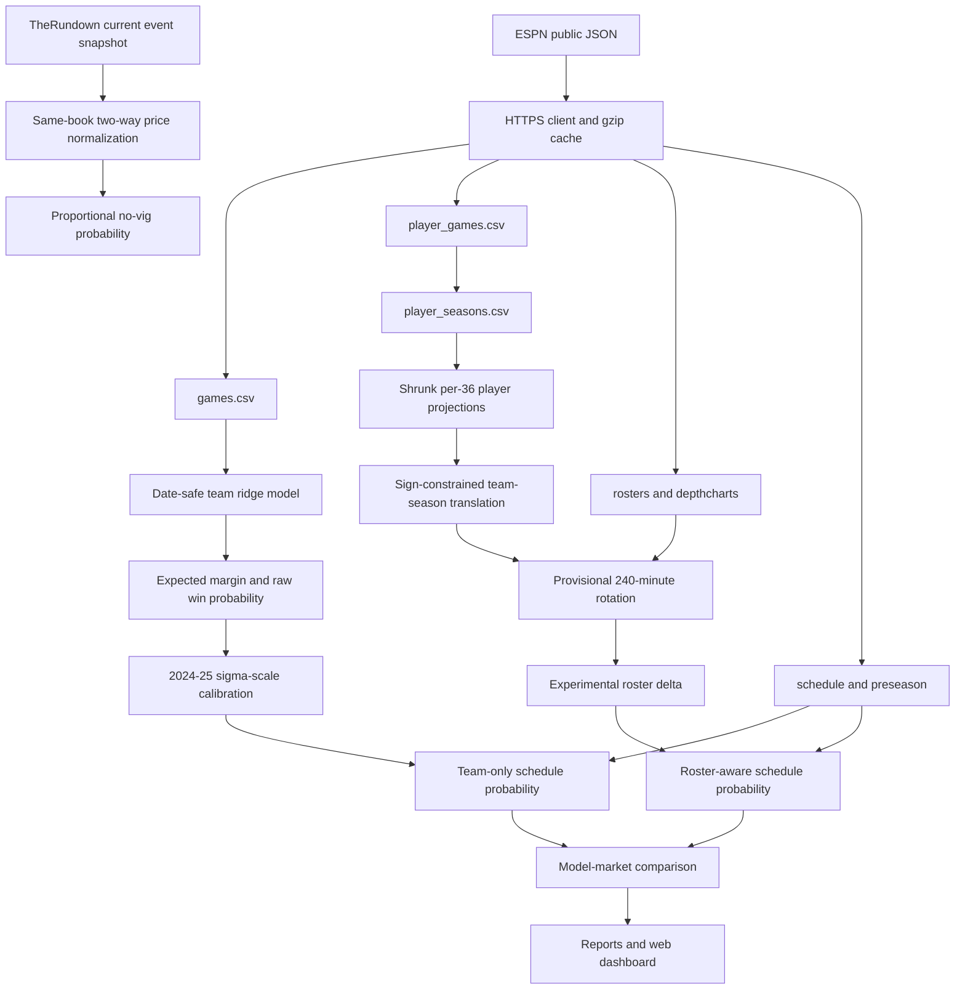

# NBA Prediction Project: Technical Architecture, Model Audit, Feature Engineering, and Integration Blueprint

**Audit date:** 2026-10-19  
**Audit type:** read-only architecture, data, model, evaluation, API, and integration audit  
**Primary repository:** `/Users/hakeembraimah/Documents/sb-model/football_model_starter`  
**Primary NBA package:** `nba/`  
**Repository commit inspected:** `0e38a618dfbff932b41b8b12c3bc6ae5f4d51c59` on `main`  
**NBA feature snapshot:** 2026-10-15  
**Target season in configuration:** 2026-27  
**Prepared for:** future evidence-led integration in which this project remains the primary architecture

## Document control and status language

This document uses the following classifications exactly:

| Classification | Meaning in this audit |
|---|---|
| **Implemented and verified** | Accessible code, configuration, data, tests, or a reproducible calculation supports the claim. Verification does not automatically establish predictive value or profitability. |
| **Implemented but not validated** | Working code or an output exists, but an appropriate historical, prospective, or market-based evaluation has not established reliability. |
| **Planned or proposed** | The item appears in the stated direction or is recommended here, but is absent from the current execution path. |
| **Unknown or unavailable** | The accessible environment cannot establish the fact. No value or result is inferred. |
| **Recommended improvement** | A technical recommendation from this audit rather than a current project capability. |

The audit did not merge repositories, change model or training logic, update source data, refresh paid APIs, or launch an expensive training run. The existing dirty and untracked web-application work was left untouched. The deliverables in this export directory are the only files created for the task.

## Scope and evidence method

The review followed dependencies from the command-line entry point through ingestion, validation, model fitting, calibration, reporting, market comparison, web integration, and tests. It inspected source, configurations, normalized datasets, reports, private local snapshots without exposing secrets, cached-source metadata, dependency declarations, and Git history. It also checked the user-named external sources against their official pages as of the audit date.

The following verification was performed without writing model outputs:

- all 24 NBA Python tests passed;
- `nba.backtest.run_backtest(write=False)` exactly reproduced every saved backtest field;
- 1,200 schedule forecasts, 30 team ratings, and 627 player projections reproduced their saved reports within floating-point tolerance of `3.6e-15`;
- all 221 web-model and feature checks passed across the available JavaScript suites;
- the JSON and normalized CSV inventories were parsed and profiled;
- no `.env` value or credential was read into this document.

Passing tests establishes the behavior encoded by those tests. It does not establish that the roster heuristic, suggested slips, player props, or betting strategy are profitable.

The friend’s or secondary project was not available. No repository path, archive, commit, dependency environment, data snapshot, model artifact, prediction file, or test result for it was accessible. Section M therefore defines an intake and comparison protocol rather than claiming to audit or merge that project.

---

## A. Executive Summary

### Objective and intended use

The project is intended to estimate NBA outcomes, compare those estimates with sportsbook prices, explain selections, construct research slips and same-game parlays, and track hypothetical performance. The present Python NBA package focuses on pregame regular-season team margin and moneyline probability. The broader web application adds current fixtures, roster context, injury/news links, bookmaker snapshots, research slip builders, player-prop SGP tooling, and a paper wallet.

The likely users are the project owner and invited testers who want transparent pregame analysis. The current code should be treated as a research system. It is not a validated automated wagering engine, does not place bets, and has not demonstrated historical profitability.

### Current maturity

The strongest component is a reproducible team-only baseline:

- four completed regular seasons of NBA results are normalized from dated ESPN game records;
- a recency-weighted ridge model estimates opponent-adjusted team strength, home court, and capped rest effects;
- expected margin is converted to home/away win probability with a normal CDF;
- a scalar probability scale is fitted only on 2024-25;
- the locked 2025-26 test contains 1,230 games;
- the entire saved backtest and report build can be reproduced locally.

On the final test, the calibrated team model recorded 63.09% accuracy, Brier score 0.2219, log loss 0.6349, margin MAE 12.036, and margin RMSE 15.314. It beat the cumulative league home-win baseline on Brier and log loss. This is evidence of a useful team-history baseline, not evidence of a profitable betting model. There is no historical odds baseline, bet ledger, ROI, closing-line value, or drawdown evaluation.

The player and roster layer is materially less mature. It projects shrunk per-36 player box production, estimates an associative team-season translation, allocates a provisional 240-minute current rotation, and applies a clipped roster margin delta. The outputs reproduce exactly, but the layer has no dated historical roster/injury/lineup backtest. All 627 stored availability values equal 1.0, and 100 players with injury flags still receive positive projected minutes in the saved build. The saved state correctly declares `roster_adjustments_validated=false`.

The web SGP model is a third analytical system. It estimates player points, rebounds, assists, and made-threes outcomes and simulates dependence with shrunken pairwise correlations. Its recorded 64-game holdout conditions on known participants and contains no real offered-line, DNP, price, profit, or Ontario FanDuel validation. Those metrics cannot be combined with the Python team-model result.

### Operational status matrix

| Capability | Actual status | Audit conclusion |
|---|---|---|
| Historical regular-season game ingestion and validation | Implemented and verified | Four seasons, 4,920 games, unique and complete within the extracted scope. |
| Dated player-game ingestion and season aggregation | Implemented and verified | 105,228 player-game records and 2,580 player/team/season stints. |
| Team margin and moneyline baseline | Implemented and verified | Reproducible chronological evaluation; retain as primary baseline. |
| Scalar probability calibration | Implemented and verified | Separate calibration/test seasons; incremental gain over raw is uncertain. |
| Current player and roster adjustment | Implemented but not validated | Reproducible heuristic, no historical outcome test. |
| Current injury/news context | Implemented but not validated | ESPN structured feed plus official-PDF link; PDF contents are not parsed. |
| TheRundown current moneyline comparison | Implemented but current entitlement not revalidated | Two-way de-vig and probability difference work; odds-history and price-age gaps remain. |
| Expected value in web options | Implemented but not validated | Formula exists; no historical edge/ROI test. Python NBA market module does not compute EV. |
| Suggested daily slips | Implemented but not validated | Probability-led builder can include no-quote, stale, or negative-EV research legs. |
| NBA player-prop SGP | Implemented but not fully validated | Conditional small holdout; no pregame participation or executable-line validation. |
| Paper wallet | Implemented but not validated | Product simulation, not evidence that recommendations would have been executable or profitable. |
| Spread probability | Implemented but not validated | Normal-margin approximation only; no historical line/cover test. |
| Game-total model | Planned or proposed | No Python NBA total target or trained model. |
| Live-game model | Planned or proposed | Pregame logic must not be represented as live validated. |
| Long-history Kaggle model | Planned or proposed | No Kaggle database exists in the repository. Actual model data begins in 2022-23. |
| Secondary/friend project integration | Unknown or unavailable | No secondary project artifacts were available. |

### Principal strengths

1. The team model enforces `history.day < forecast day` and contains an explicit same-day/future-mutation leakage test.
2. Calibration and final test seasons are separated.
3. Configuration values are explicit and output files include important input hashes.
4. The ingestion pipeline uses dated game boxes rather than present-day survivor lists for historical players.
5. The project clearly labels roster effects as unvalidated in several code and report locations.
6. Market normalization requires same-book, two-sided prices and removes proportional overround.
7. The Python and TypeScript implementations have parity checks, even though coverage should expand.

### Principal limitations

1. The model-selection process is not documented. No Elo, regularized win model, CatBoost, LightGBM, XGBoost, random forest, or other comparable NBA experiment exists.
2. Feature selection is manual/domain-driven. There are no fold-local ablations, permutation importance, SHAP, mutual information, stability tests, or recorded rejection decisions.
3. The player/roster adjustment is associative and current-snapshot-based, not historically validated.
4. The final test may no longer be pristine if the fixed configuration was selected after viewing it; parameter provenance is unavailable.
5. Odds history is absent. A stored provider response can be newly fetched while its individual price was last updated weeks earlier.
6. There is no market-implied historical baseline, ROI, CLV, P&L, maximum drawdown, or realistic execution study.
7. The Python dependency file contains lower bounds rather than an exact lock.
8. Raw ESPN provenance and private odds payloads are ignored by Git and are not portable with an ordinary clone.
9. NBA.com terms present a major rights issue for using NBA Statistics in a gambling-related or commercial product without consent.

### Overall assessment

The project has a credible reproducible baseline and useful research scaffolding. It should not yet be rated as having a known “result probability” for betting success. The measured 63.09% is the accuracy of team-only home/away classification on one season; it is neither the probability that a suggested slip cashes nor a guarantee of future performance. The next improvement should be a disciplined experiment and data-timing framework, not more parlay legs or a more complex algorithm by default.

---

## B. System Architecture and Execution Flow

### Current architecture



The architecture contains two partly separate implementations:

- The Python package builds the normalized NBA datasets, runs the audited team backtest, produces current-season forecasts, and compares current moneylines.
- The web package consumes exported seeds and current runtime feeds, mirrors the team calculations in TypeScript, adds current roster/news/injury context, builds slips, and implements a separate SGP model.

### Command-line entry points

`nba/__main__.py:10-57` defines the public Python commands:

| Command | Execution role | Status |
|---|---|---|
| `sync` | Fetch and normalize public team, schedule, roster, depth, and dated box data | Implemented and verified against existing artifacts; live source schemas were not re-pulled for this audit. |
| `connection` | Check and store non-secret TheRundown connection metadata | Implemented; current entitlement not rechecked. |
| `rundown-events` | Fetch a dated event snapshot to a private path | Implemented. |
| `compare-odds` | Pair moneylines, remove overround, and compare probabilities | Implemented and verified for transformation behavior. |
| `build` | Refit and write reports for the configured target season | Implemented and reproducible. |
| `backtest` | Run chronological team-only evaluation and write predictions/calibration | Implemented and exactly reproducible. |
| `forecast` | Produce a point forecast for a selected game | Implemented. |

The intended operational order is `sync`, `backtest`, and `build`, with provider connection/events and odds comparison as optional current-market steps.

### Step-by-step data flow

1. **HTTP retrieval.** `nba/http_client.py` requires HTTPS, invokes system `curl`, passes sensitive headers through standard input rather than command arguments, restricts redirects to the same host, retries network/429/5xx failures, and caches response wrappers by URL hash.
2. **Game ingestion.** `nba/ingest.py` enumerates teams and per-team schedules. It deduplicates games, separates completed regular-season games, completed preseason games, and future regular-season schedule rows, and records provider/fetch timestamps.
3. **Historical player ingestion.** Dated game summary endpoints produce one row per named player-game. Season aggregation produces one player/team/season stint, preserving traded-player team stints.
4. **Current roster ingestion.** Current rosters and depth charts are fetched separately. These are target-season snapshots, not historical roster tables.
5. **Validation.** The game loader rejects missing required columns, nonpositive/noninteger completed scores, ties, same-team games, and duplicate IDs. Ingestion writes a data-quality summary and box-score gap audit.
6. **Team feature construction.** For every historical game, the matrix contains a home-team `+1`, away-team `-1`, a non-neutral home indicator, and the difference in capped rest days.
7. **Training.** For a forecast date, only earlier game days are used. Each game receives an exponential age weight. Ridge penalties differ between team, home, and rest parameters.
8. **Probability conversion.** Expected margin is divided by the weighted residual scale and mapped through the standard normal CDF. The saved calibration multiplies residual scale by 0.7372426 for final-test and target-season probabilities.
9. **Player projection.** Four preceding player seasons receive weights 0.125, 0.25, 0.5, and 1.0. Per-36 rates shrink toward the league mean with 750 prior minutes.
10. **Roster translation.** Ten player box features are mapped to season-end team rating using a constrained associative regression. A provisional rotation is allocated from historical minutes and depth role.
11. **Current forecast.** The current-minus-previous roster proxy is blended by 0.5 and clipped to ±8 points, then added to the team margin. Both team-only and roster-aware values are retained in outputs.
12. **Odds normalization.** TheRundown event prices are normalized, paired only within a complete same-book two-way moneyline, and de-vigged proportionally.
13. **Decision/display.** Python reports probability differences. The web service additionally calculates an edge and one-unit EV, attaches freshness/support flags, composes research slips, and shows explanations and cautions.
14. **Result tracking.** The web paper-wallet flow can settle supported historical recommendations. It is a product simulation, not a market-valid historical backtest because recommendation prices and eligibility have not been comprehensively archived and validated.

### Architecture gaps

The current flow has no immutable cross-provider event registry, historical roster/injury snapshot store, versioned feature store, serialized model artifact, exact dependency lock, experiment database, or historical odds warehouse. The TypeScript mirror duplicates mathematical logic. The suggested-slip path and the strict single-leg eligibility path are not the same policy.

The target modular architecture is specified in `NBA_Project_Integration_Blueprint.md` and centers on provider observation envelopes, canonical identity, as-of feature vectors, versioned model manifests, immutable odds observations, and recommendation/settlement records.

---

## C. Dataset Inventory and Preparation

### Actual source scope

The normalized NBA training data in this repository comes from ESPN public JSON endpoints and covers four seasons beginning in 2022-23. The design statement about a Kaggle database dating to 1946 is not the state of this project. No Kaggle SQLite database, download script, schema mapping, or extracted table was found.

The normalized datasets are tracked. The raw ESPN response cache, private odds snapshots, and `.env` are ignored. An ordinary Git clone can reproduce the saved model from the committed normalized CSVs, but cannot independently reconstruct the upstream extraction or current odds comparison without refetching.

### Dataset inventory

| Dataset | Location | Unit and primary key | Rows | Coverage | Main predictors or labels | Important limitations |
|---|---|---|---:|---|---|---|
| Historical games | `nba/data/games.csv` | One completed game; `game_id` | 4,920 | 2022-10-18 to 2026-04-13 UTC; 1,230 per season | teams, date, home/away points, neutral, season type | Only four seasons; no possession or odds fields. |
| Player games | `nba/data/player_games.csv` | One named player-game; `(game_id, player_id)` | 105,228 | Same four seasons | minutes and box totals for 877 players | Provider display minutes may be rounded; seven team-score gaps exist. |
| Player seasons | `nba/data/player_seasons.csv` | One player/team/season stint; `(player_id, season, team_id)` | 2,580 | Seasons ending 2023-2026 | games, minutes, shooting, rebounds, assists, steals, blocks, turnovers | Whole-season aggregates are safe for a later season but cannot be used inside the same season without an as-of rebuild. |
| Teams | `nba/data/teams.csv` | One ESPN team; `team_id` | 30 | Current catalog | ID, abbreviation, name | Provider-specific identity. |
| Current rosters | `nba/data/rosters.csv` | One current roster player; `player_id` | 627 | Snapshot 2026-10-15 04:25 UTC | team, age, injury text, depth fields, history flag | 121 players lack NBA history; all projected-minutes fields are blank at source; 493 injury statuses blank. |
| Depth charts | `nba/data/depthcharts.csv` | Player-position-depth row | 994 | Snapshot 2026-10-15 04:46 UTC | position and rank for 525 players | 104 roster players have no depth row; two depth identities are not in current roster. |
| Future schedule | `nba/data/schedule.csv` | One scheduled regular-season game; `game_id` | 1,200 | 2026-10-20 to 2027-04-12 UTC | teams, date, status, neutral | 80 known games per team; two Cup-dependent games per team unresolved. |
| Preseason | `nba/data/preseason.csv` | One completed preseason game | 52 | 2026-10-03 to 2026-10-15 UTC | scores and teams | Context only; model weight is exactly zero. |
| Box gap audit | `nba/data/boxscore_audit.csv` | One affected game/team | 7 | Four-season extract | unassigned team-score points | 28 total points; raw row field is repeated on player rows and must not be summed directly. |
| Rotation overrides | `nba/data/rotation_overrides.csv` | One manual player override | 0 | None | intended projected minutes/availability | Header only; no manual override is active. |
| Data-quality report | `nba/data/data_quality.json` | One build summary | 1 | Build snapshot | counts, failures, no-history players, gaps | Does not replace raw-source provenance. |
| Backtest predictions | `nba/reports/backtest_predictions.csv` | One historical forecast | 3,690 | 2023-24 development, 2024-25 calibration, 2025-26 test | actual/predicted margin, raw/baseline/calibrated probability | Calibrated probability is populated only for the 1,230 final-test rows by design. |
| Backtest summary | `nba/reports/backtest.json` | One experiment summary | 1 | Saved four-season experiment | parameters, metrics, intervals, reliability bins | No odds or roster layer. |
| Calibration | `nba/reports/calibration.json` | One scalar calibration artifact | 1 | Fitted through 2024-25 | `sigma_scale=0.73724261462587` | One calibration method only. |
| Model state | `nba/reports/model_state.json` | One target-season build manifest | 1 | As of 2026-10-15 | parameters, fitted summary, input hashes | Omits code/Git/runtime hashes and several input artifacts. |
| Schedule forecasts | `nba/reports/schedule_forecasts.csv` | One future game forecast | 1,200 | 2026-27 known schedule | team-only and roster-aware probabilities/margins | Roster-aware values unvalidated; schedule rest can change after postponements. |
| Player projections | `nba/reports/player_projections.csv` | One current roster player | 627 | 2026-27 snapshot | per-36 features, minutes, impact, status | Current heuristic; no prediction interval. |
| Roster changes | `nba/reports/roster_changes.csv` | Membership change row | 608 | Previous contributors versus current roster | arrival/departure and proxy contribution | Not an authenticated transaction or salary ledger. |
| Team outlook | `nba/reports/team_outlook.csv` | One team | 30 | 2026-27 build | team rating, roster delta, expected wins over known schedule | Inherits roster and schedule limitations. |
| Historical team performance | `nba/reports/historical_team_performance.csv` | One team-season | 120 | Four seasons | wins, losses, scores and rating context | Descriptive output. |
| Private market comparison | `nba/data/private/market_comparison.csv` | One event/book comparison | 4 | Two events in a local snapshot | price, no-vig chance, model differences | Git-ignored, too small for evaluation, and price update times are stale in places. |
| Raw ESPN cache | ignored `.cache`/raw paths used by client | One response wrapper | 5,883 files | Fetch window 2026-10-15 04:25-04:46 UTC | response body, source URL, fetch time, safe headers | 212,805,451 bytes; includes 722 obsolete first-pass athlete/catalog calls; redistribution rights unverified. |

### Hashes for principal normalized inputs

| File | SHA-256 |
|---|---|
| `games.csv` | `fd176f2cc212b50d778a10a62ffe3762fa91d95a7231cca2c528003ab39c2dd0` |
| `player_games.csv` | `b52f6023c6518d169e63c68f015753acf700d6d360c4cb8620d03d4fdd33c686` |
| `player_seasons.csv` | `6c89fb4e015ecdb4f5804efa712b9901d68f2f36a44c513825422aaf16b2a3f6` |
| `rosters.csv` | `4bc9e6836d5c5376d368cc813a153ef012dacf31dbe56bbdc21ad2b74de0595b` |
| `depthcharts.csv` | `676552c58729d17960fb4841aa66b2c85cbfff2c368578c416b61335db4b7837` |
| `schedule.csv` | `45f141356060b6c6bc3a3b0d53b3171850154b83fbc16c7fe90b4271cc3c4732` |

### Unit of observation and joins

The team model’s training unit is one completed regular-season game. The target is one home-team point margin. Team IDs join home and away observations to the coefficient vector. Date and team determine prior rest state.

The historical player unit is one named player-game. It joins to games on `game_id`, to a team on `team_id`, and to a player on `player_id`. The aggregation unit is a player/team/season stint, which correctly permits one traded player to have multiple season rows.

The current roster unit is one player in a target-season snapshot. Depth charts can contain multiple position rows per player, so their natural key is closer to `(team_id, player_id, position)` than `player_id`. The project must resolve the two depth-only identities and the 104 roster players without depth before relying on complete role coverage.

The odds comparison unit is one event, book, market, side, and line observed at a time. The current private comparison has only event/book aggregates for two moneyline events. It is not a historical price table.

### Raw records to training examples

`nba/ingest.py:241-340` parses dated game summaries to player-game rows. It reconciles named player points with final team scores and records gaps. Season aggregation then sums games, minutes, makes/attempts, rebounds, assists, steals, blocks, and turnovers by player/team/season.

`nba/model.py:12-30` filters the team table to completed regular-season games and converts timestamps to normalized Toronto dates. `design_matrix` processes games in date order. For a historical prediction on date `d`, `fit_team_model` selects only rows with `day < d`; it does not use the current game or another result later on the same date.

The player/roster report path uses completed preceding seasons for target-season projections. It should not be generalized to an in-season historical backtest without rebuilding player aggregates as of every simulated date.

### Cleaning and transformation

- Completed scores must be positive integers and cannot tie.
- Duplicate game IDs and same-team fixtures are rejected.
- Neutral games remove the home-court indicator.
- Rest is days between appearances minus one, clipped to zero through three.
- Team-game age becomes an exponential sample weight rather than a predictor column.
- Player counts become per-36 rates after season weighting and 750-minute empirical shrinkage.
- Ten player features are standardized for the team-season translation.
- Current rotation weights are normalized to 240 minutes and capped at 40 minutes per player.
- Moneylines are normalized to decimal prices; a complete same-book pair is de-vigged proportionally.

No general scaler is applied to the team ridge design because its columns have defined indicator/day units and receive explicit penalties. The player translation standardizes features inside the fit, but there is no serialized preprocessing artifact or fold-by-fold historical validation.

### Missing data and data-quality findings

The historical games and player-game natural keys are complete and duplicate-free in the accessible extracts. Important current-snapshot gaps remain:

- 121 of 627 roster players have no accessible prior NBA history;
- 104 roster players have no depth-chart entry;
- 493 roster injury-status cells are blank;
- all 627 source `projected_minutes` values are blank;
- all modeled availability multipliers default to 1.0 in the saved Python build;
- seven Chicago game boxes contain 28 final-score points not assigned to named players.

The last issue has an additional semantic defect. `parse_boxscore` copies the same team-level unassigned-points gap onto each player row for the affected team, while the later audit deduplicates it to recover 28. Summing `player_games.unassigned_team_points` directly produces 248. The field is currently unused by the model, but it must be normalized to a separate game-team table or populated on one row only before integration.

### Historical coverage limitations

Four seasons can support a baseline evaluation, but not extensive algorithm and feature search with a robust untouched final period. The candidate long-history cutoffs around 2010-11, 2014-15, and 2017-18 cannot be compared until an immutable long-history dataset is imported and its definitions, IDs, completeness, and rights are verified.

Older NBA eras differ in pace, shot mix, rules, tracking availability, roster construction, and statistical definitions. A longer table is not automatically a better training window. The cutoff experiment must test recency, era drift, and feature availability rather than pool 1946-present indiscriminately.

---

## D. Prediction Targets and Metrics

### D1. Home point margin

**Status:** Implemented and verified.

For game `g`:

```text
y_g = home_points_g - away_points_g
```

The unit is one completed regular-season game. Postponed, incomplete, preseason, and non-regular-season rows are excluded. The prediction is generated before the game date using prior completed games. Metrics are MAE and RMSE on the final test.

The current model forecasts an expected margin, not a complete calibrated score distribution. Residual SD is a single weighted training residual scale, so uncertainty does not change with matchup, lineup uncertainty, pace, or season phase.

### D2. Home and away moneyline probability

**Status:** Implemented and verified for the team-only model; implemented but not validated for the roster-aware extension.

The raw home probability is:

```text
p_home_raw = Phi(expected_margin / residual_sigma)
```

The calibrated form is:

```text
p_home = Phi(expected_margin / (residual_sigma * sigma_scale))
p_away = 1 - p_home
```

where `sigma_scale=0.73724261462587` was selected on 2024-25 by bounded log-loss minimization. The final test is 2025-26. Metrics are log loss and Brier score, with accuracy secondary and ten-bin reliability summaries. NBA games cannot finish tied; postponed/incomplete games are absent from labels.

The roster-aware probability adds a current roster margin delta before the same conversion. No measured historical metrics belong to that extension.

### D3. Spread-cover probability

**Status:** Implemented but not validated.

The report/web path can combine a quoted spread line with the normal margin approximation. No historical spread-line dataset, cover label table, push treatment analysis, calibration, or proper-score result exists. It must not inherit moneyline validation merely because the same expected margin is used.

### D4. Game total and over/under

**Status:** Planned or proposed for NBA.

The Python NBA core does not predict home points, away points, total points, or over/under probability. A total model needs a target such as `home_points + away_points`, pace/possession information, an explicit conditional distribution, and timestamped total lines for cover/over evaluation.

### D5. Player-statistic and SGP prop probabilities

**Status:** Implemented but not fully validated in the web model; absent from the Python NBA core.

The web SGP model supports points, rebounds, assists, and made threes. It estimates marginal hit rates at generated or manually entered lines using strictly earlier player games, sample thresholds, smoothing, role/minutes, and opponent adjustments. It then estimates a joint parlay probability through shrunken rank correlations and deterministic simulation.

The recorded evaluation includes 1,663 conditional prop outcomes over 64 games. It knows who participated and does not test historical offered lines, book prices, DNP/injury uncertainty, or profit. The correct future target is one player-market-line outcome as observed at a defined decision cutoff, with pushes and voids encoded using the relevant book rules.

### D6. Live-game win probability

**Status:** Planned or proposed.

No live target, clock/score/possession state, in-game injury state, market-suspension treatment, or live evaluation exists. Current pregame logic cannot be presented as a validated live model.

### Metric appropriateness

Log loss and Brier score are appropriate primary measures for moneyline probability. Accuracy should remain secondary because it ignores probability quality and price. Margin MAE/RMSE are appropriate for expected-margin error but do not assess interval coverage or tail risk. ROC-AUC can be reported as a discrimination diagnostic, but should not replace proper scoring rules or calibration.

For betting use, probability metrics must be followed by a separate evaluation using executable timestamped prices. Required decision metrics include number of qualified bets, win rate by market, stake and payout conventions, P&L, ROI, closing-line value, maximum drawdown, turnover, edge/probability bins, book/market breakdown, and confidence intervals. None is currently available for the Python NBA model.

---

## E. Model Selection Process

### E1. Recency-weighted ridge margin model

**Status:** Implemented and verified.  
**Library:** NumPy linear algebra with pandas preparation; SciPy is used for later probability functions.  
**Target:** home point margin.  
**Evidence:** `nba/model.py:37-117`, `nba/config.py:25-44`, and `nba/reports/backtest.json`.

For `n` games and `T` teams, the design matrix has `T+2` columns. Team columns are opponent contrasts, followed by home court and rest difference. The fitted coefficients solve:

```text
beta = (X' W X + Lambda)^(-1) X' W y
```

with:

- `W_gg = 2^(-age_days_g / 365)`;
- team diagonal penalty 35;
- home-court penalty 0.01;
- rest penalty 100;
- minimum 300 training games;
- no random seed because the solve is deterministic;
- no early stopping;
- no automated hyperparameter search;
- no recorded training duration in the stored artifact.

This model is a sensible baseline because the sample is modest, the team contrast is interpretable, and ridge stabilizes the non-identifiable sum of team effects. The available files do not contain a contemporaneous model-selection rationale or evidence that it beat alternative models. It was selected by implementation, not by a recorded comparative experiment.

### E2. Normal-CDF probability conversion and scalar calibration

**Status:** Implemented and verified.

The weighted in-sample residual RMSE, floored at five points, provides a common margin scale. A standard normal CDF converts margin to win probability. `nba/backtest.py:32-38` selects one multiplicative sigma scale on the 2024-25 calibration season by bounded scalar minimization of log loss over `[0.65,1.75]`. The selected scale is 0.73724261462587.

This is a temperature/variance adjustment. It is not Platt scaling, isotonic regression, beta calibration, or a full distributional model. The saved final-test improvement over the raw probability has a 95% date-bootstrap interval crossing zero, so the data does not clearly establish that calibration variant as better than raw.

### E3. Cumulative home-win baseline

**Status:** Implemented and verified.

Before each game date, the baseline is:

```text
(historical home wins + 1) / (historical games + 2)
```

It is a useful naive check and is date-safe. It is weak as the principal comparator because it ignores team identity and market information. Beating it establishes more than always choosing home, but not state-of-the-art quality or betting advantage.

### E4. Player box-production translation

**Status:** Implemented but not validated.  
**Library:** SciPy `lsq_linear`; NumPy/pandas.  
**Target:** completed-season team rating from the team model.  
**Evidence:** `nba/players.py:14-102`.

The player feature vector contains points, missed field goals, missed free throws, offensive rebounds, defensive rebounds, assists, steals, blocks, turnovers, and made threes. Player per-36 values are season-weighted and shrink toward a league prior. Team-season production is converted to a five-player per-36 aggregate. Team-seasons need at least 80% observed minutes.

The translation standardizes predictors, augments the design with `5 * I`, and constrains missed shots/turnovers nonpositive and the remaining coefficients nonnegative. There are 120 training team-seasons. This is an association between team box composition and an outcome-derived team rating. It is not adjusted plus/minus, causal player value, or a historical game-level validation.

The saved coefficients are:

| Feature | Coefficient |
|---|---:|
| Points | 0.24718194 |
| Missed field goals | -0.89401466 |
| Missed free throws | -0.19348969 |
| Offensive rebounds | 0.89111636 |
| Defensive rebounds | 0.75115488 |
| Assists | approximately 0 |
| Steals | 0.83978783 |
| Blocks | 0.27011880 |
| Turnovers | -1.33529523 |
| Made threes | 0.52048764 |

Points overlap mechanically with makes and misses, and several box features reflect role, pace, or position. The assist coefficient collapsing to zero is evidence that at least one retained feature adds no signal under the current constrained fit. No correlation/stability report or held-out ablation exists.

### E5. Current roster-aware model

**Status:** Implemented but not validated.

The rotation heuristic blends historical MPG and depth priors, keeps an 11-player rotation, normalizes to 240 minutes, caps each player at 40, and applies availability. The current rotation proxy is compared with previous-season contributors. Half the raw difference is applied and clipped to ±8 points.

Exact parameters:

- `roster_blend=0.5`;
- `max_roster_adjustment=8.0`;
- `player_shrinkage_minutes=750.0`;
- season weights from oldest to newest: 0.125, 0.25, 0.5, 1.0;
- depth priors: 30, 18, 8, and 3 minutes by role tier;
- 240 team minutes and 40-minute player cap;
- neutral league production prior for players without history;
- availability defaults to 1 unless overridden.

No experiment explains why these values were chosen. The model state explicitly declares the adjustment unvalidated. It must remain an experimental scenario layered on the verified team-only result.

### E6. Web SGP player-copula model

**Status:** Implemented but not fully validated.  
**Version:** `player-copula-v1.1`.  
**Target:** joint probability that selected player props cash.

The model uses points, rebounds, assists, and made threes; strictly earlier player games; four-season/current history; minimum sample and minutes gates; conservative generated thresholds; two pseudo-observations for hit-rate smoothing; opponent and role multipliers; shrunken rank correlation; and 65,536 deterministic simulations. Pair correlations require at least 12 shared games, shrink by `n/(n+30)`, and are clipped to ±0.9. A matrix-shrink repair is used if the correlation matrix is invalid.

The holdout has 64 NBA games and 1,663 conditional player props. Mean predicted probability was 0.8364, observed hit rate 0.8749, and Brier score 0.11063. Forty-one target-40 slips produced one observed win against 0.905 expected wins. These figures are exploratory because the evaluator conditions on known participants and does not use historical offered lines, actual book odds, pregame DNP/injury uncertainty, or profit. The small result should not be interpreted as a 100% slip cash rate.

### E7. Decision and paper-wallet rules

**Status:** Implemented but not validated.

The web service calculates fair odds, no-vig edge, and single-leg EV when a quote exists. A strict `eligible` flag requires support/freshness, probability at least 55%, edge at least 2.5 percentage points, and EV at least 2%. The suggested-slip builder uses the broader `suggestionEligible` flag and can retain dated, no-price, or negative-EV research candidates. It can use model-fair odds when a bookmaker price is absent.

The paper wallet starts at CAD 200 and can apply CAD 5 to each supported daily non-SGP suggestion profile. This is product behavior, not a validated wagering experiment, because the suggestion set and prices were not archived under a fixed historical decision policy.

### E8. Algorithms not implemented

| Algorithm or model | Status | Audit conclusion |
|---|---|---|
| Elo / margin Elo | Planned or proposed | Required strong baseline; no NBA implementation found. |
| Regularized win logistic/probit | Planned or proposed | Required probability-native baseline; no implementation found. |
| CatBoost | Planned or proposed | No package, training code, search space, or result. |
| LightGBM | Planned or proposed | No package, training code, search space, or result. |
| XGBoost | Planned or proposed | No package, training code, search space, or result. |
| Random forest / extra trees | Planned or proposed | No NBA implementation or result. |
| Neural network | Unknown or unavailable | No evidence it was considered beyond general possibilities. |
| Poisson/negative-binomial score model | Planned or proposed | Useful candidate for score/total modeling; absent. |
| Adjusted plus-minus or RAPM | Planned or proposed | Current player translation is not RAPM. |
| Market-implied baseline | Planned or proposed | Current no-vig comparison exists, but no historical baseline evaluation. |

### Model-selection conclusion

There was no rigorous recorded selection process. No search space, candidate list, equal-budget comparison, failed experiment, feature-set version, or selection decision is preserved. The current ridge approach is defensible as a baseline, but the available evidence cannot establish that it was chosen over better alternatives. The experiment register supplied with this audit distinguishes measured rows from proposed comparisons.

---

## F. Feature Engineering and Feature Selection Audit

The complete row-level inventory is in `NBA_Feature_Catalog.csv`. This section explains the principal groups, their timing, and the required selection framework.

### F1. Team quality and ratings

The core feature is a regularized team-strength contrast. It is opponent-adjusted through the joint home/away design rather than a raw win percentage. Exponential weighting gives recent games more influence without defining explicit last-5/10/20/40 windows.

**Status:** Implemented and verified.  
**Evidence of usefulness:** the complete baseline package beats the cumulative home-rate baseline in the 2025-26 test.  
**Missing evidence:** no add/remove ablation separates team identity from home/rest and no half-life/penalty tuning provenance exists.

### F2. Home and away effects

A single non-neutral home indicator estimates a common home-court value of 1.7740 points in the saved target-season state. There are no team-specific home effects, venue altitude, crowd/travel interactions, or playoff variations.

**Recommended action:** preserve the common effect in B0. Consider richer home/venue terms only if multi-season temporal validation shows stable gain.

### F3. Rest, fatigue, travel, and scheduling

The model calculates a rest-day difference, with each side clipped to zero through three days. The saved coefficient is 1.0518 margin points per capped day difference. The feature captures back-to-back pressure indirectly but omits travel distance, time-zone change, altitude, road-trip length, condensed schedule, and overtime workload.

**Leakage assessment:** safe in the historical backtest because last-seen dates advance only after each date group. Future schedule forecasts depend on the currently published schedule, so postponements can make projected rest stale.

### F4. Recent form

There is no explicit last-5/10/20/40 feature in the Python core. The 365-day exponential weight is the only formal recency mechanism. The web UI also creates a recent-form sentence from previous results, but the sentence is explanatory context, not an independently fitted coefficient.

**Recommended action:** compare explicit rolling windows with the smooth decay. Calculate every window with `shift(1)` or an as-of join and fit/select it inside each temporal fold.

### F5. Offensive/defensive efficiency, pace, and Four Factors

**Status:** Planned or proposed.

No modeled possessions, pace, offensive rating, defensive rating, net rating, effective field-goal percentage, turnover rate, offensive-rebound rate, or free-throw rate feature exists. The player tables contain some raw box components, but the team game table used by the core does not expose possession features.

This is the highest-priority basketball feature group after data rights and as-of storage are solved. Opponent-adjusted rolling offense and defense can explain score level and matchup beyond one team coefficient. Correlated variants should enter as a coherent group and be pruned only inside the training folds.

### F6. Player performance and aging

Historical player production is season-weighted, normalized per 36, and shrunk. This correctly avoids equal career weighting. Age is present on current rosters but unused. Role is represented indirectly by historical MPG and depth rank.

**Strength:** explicit shrinkage protects low-minute players.  
**Weakness:** four whole-season aggregates discard within-season form and cannot represent an aging curve.  
**Leakage risk:** medium for target-season preseason use, high if whole-season aggregates are backfilled into earlier dates.  
**Recommended action:** construct age-at-game, rolling role/minutes, and availability from historical snapshots. Compare short player windows with a longer team window, as intended by the user.

### F7. Player availability, expected minutes, lineups, and bench

Current rotation minutes are a heuristic. The project has no historical expected-minutes labels, active lists, confirmed starters, or lineup-continuity table. Official injury PDF contents are not parsed; only a link is discovered. The web injury logic excludes only recent explicit Out/Suspended/Inactive cases for fixtures within 48 hours.

This feature group has high potential impact and the highest leakage risk. Final participant lists and revised injury statuses must never be joined backward. Store every report as observed and simulate one or more fixed decision cutoffs, such as morning, 90 minutes, and 30 minutes before tip-off.

### F8. Player and stylistic matchups

The SGP model contains an opponent allowance modifier and shared-game dependency estimates. The team moneyline model has no player-to-player, positional, switching, rim, three-point, rebounding, or pace-style interactions.

Opponent matchup features tend to be noisy and sample-limited. Retain them only after strong shrinkage and multiple-season ablation. A narrative “player performs well against this opponent” sample should never override a larger role/opportunity model without evidence.

### F9. Season timing and motivation

Preseason is explicitly context-only and receives zero weight. There is no standings, playoff leverage, tanking, playoff-rest, trade-deadline, or season-phase feature.

**Recommended action:** first define measurable as-of variables. Treat narrative motivation as research-only until a reproducible feature provides stable incremental value.

### F10. Injuries and news

Current ESPN injury rows and team headlines are displayed in the web application. Headlines do not receive a fabricated sentiment score. The official report index supplies a manual verification link. No historical injury/news archive is used by the Python backtest.

**Recommended action:** preserve text as context. Before numerical use, archive timestamps, link players/events, define status transitions, measure probability of participation, and evaluate the feature group prospectively or on a licensed historical archive.

### F11. Sportsbook prices and movement

The project de-vigs current complete moneylines, but has no historical movement series. A response can be fetched after the model snapshot while an individual price’s provider update time predates the model snapshot. The web freshness check primarily treats poll observation time as current.

**Recommended action:** store both observation and provider update times, book, jurisdiction, market, line, and closure. Reject a quote whose price timestamp precedes the feature snapshot or exceeds a market-specific age. Treat market probability as a benchmark and later as a separate stacking/decision feature.

### F12. Referees, coaching, rotations, and context

**Status:** Planned or proposed. No source or implementation exists.

These are lower-priority features because assignments/change dates are difficult to reconstruct, effects can be unstable, and repeated testing invites overfit. They should follow efficiency, schedule, and availability groups.

### Existing feature-selection procedure

The current procedure is domain-driven manual inclusion plus ridge shrinkage. Ridge regularization stabilizes coefficient estimates; it is not evidence that every feature adds out-of-time predictive value. The player translation adds sign constraints and an L2-like augmentation. There is no recorded:

- correlation/redundancy screen;
- mutual information analysis;
- recursive feature elimination;
- L1/elastic-net selection;
- permutation importance;
- SHAP analysis;
- feature-group ablation;
- stability selection;
- fold-local preprocessing/selection pipeline;
- formal acceptance/rejection threshold.

### Leakage-safe feature-selection framework

#### 1. Freeze targets and decision cutoffs

Define separate experiment families for margin, moneyline, total, spread-cover, and each player-prop statistic. For each family, specify when a prediction is assumed to be made. Game-day features must be those observed by that cutoff.

#### 2. Create chronological folds

After acquiring longer history, compare data cutoffs of 2010-11, 2014-15, and 2017-18. Use several expanding-window development folds. Reserve a calibration season for the final fit and one untouched final season. Do not reuse the final season to choose features, half-lives, or models.

#### 3. Establish baselines

- B-1 cumulative home rate;
- B0 current ridge team/home/rest model;
- B1 online Elo or margin Elo;
- B2 regularized win logistic/probit;
- B3 no-vig market probability at the exact cutoff after a licensed archive exists.

#### 4. Version coherent feature groups

- G0 team strength, home, rest;
- G1 pace, offense, defense, Four Factors;
- G2 schedule density, travel, time zones, altitude;
- G3 expected minutes and probability of playing;
- G4 lineup quality, continuity, role, age, bench;
- G5 stylistic and player-opponent interactions;
- G6 season phase/context;
- G7 market price and movement.

#### 5. Fit transformations inside each training fold

Imputation values, scaling, encoding, correlation filters, PCA if any, importance rankings, and selected feature lists must be learned from the training portion only. Validation rows are transformed by the fitted training artifact. The same rule applies to player priors, opponent ratings, and lineup embeddings.

#### 6. Add and remove groups

First add each group to B0 separately. Then combine groups whose gain repeats. For the combined candidate, remove each group in turn. This distinguishes a feature that is useful alone from one that remains useful after the main correlated signal is present.

#### 7. Measure multiple dimensions

For probabilities, compare log loss, Brier, calibration slope/intercept, expected calibration error with uncertainty, and reliability by probability bin. For margins/totals, compare MAE, RMSE, and interval coverage. Report mean and dispersion by fold and season.

Permutation importance should be computed on each validation fold and grouped for correlated features. SHAP can diagnose nonlinear models, but a high SHAP magnitude is not a retention criterion. Repeat rankings across seasons and seeds.

#### 8. Evaluate market decisions separately

After probability selection is locked, join only odds observed by the decision cutoff. Compare with no-vig market probabilities. Test conservative EV using a lower probability bound, and report CLV, ROI, P&L, drawdown, and edge bins. Market results cannot rescue a feature whose timing is invalid.

#### 9. Apply a retention rule

Retain a group only when it improves proper scores by a preregistered practical amount in most folds, preserves or improves calibration, survives remove-one-group ablation, remains stable across at least two seasons, has reliable availability, and offers benefit proportional to complexity. Transform/simplify a group when a smaller summary keeps the gain. Reject it when benefit is isolated, sign-unstable, timing-unsafe, or absent after stronger baselines.

#### 10. Record every decision

Each run must write a manifest row containing experiment ID, Git SHA, clean/dirty status, runtime lock, input hashes, cutoff, folds, target, feature version, parameters/search space, seeds, training time, predictions, metrics, and keep/reject decision. The supplied `NBA_Model_Experiment_Register.csv` is the starting schema.

### Exact first experiment series

1. Reproduce B0 on the current four-season extract.
2. Add Elo and regularized win logistic/probit on identical daily folds.
3. Import and version an approved long-history dataset.
4. Run cutoff comparison C2010, C2014, and C2017 using the same B0/B1/B2 family.
5. Select a training-window policy using development folds only.
6. Add G1 efficiency/pace, then G2 schedule/travel.
7. Build historical roster/injury/lineup snapshots before G3/G4.
8. Lock the best small pure-basketball model and calibrator.
9. Add the historical market baseline and evaluate whether model information survives vig and timing.
10. Run a prospective shadow season before changing product claims.

---

## G. Training Procedure and Model Parameters

### Inclusion and exclusion rules

The team model includes completed regular-season games (`season_type==2`) with legal scores. Preseason, postseason, incomplete, and future games are excluded. A forecast on day `d` uses only `day < d`. There is no rolling maximum lookback; all accessible earlier seasons enter with exponential decay.

The four-season backtest requires exactly four season values. It predicts the last three seasons daily, treating the first as initial history. The second is development output, the third is calibration, and the fourth is final test.

### Saved temporal split

| Role | Season | Use |
|---|---|---|
| Initial history | 2022-23 | Supplies prior games for early development predictions. |
| Development | 2023-24 | Historical predictions produced; no explicit selection log shows how they were used. |
| Calibration | 2024-25 | Fits the scalar probability scale only. |
| Test | 2025-26 | Reports locked team-only metrics. |

### Exact team-model parameters

| Parameter | Code name | Value | Provenance |
|---|---|---:|---|
| Recency half-life | `half_life_days` | 365.0 | Explicit default; selection experiment unavailable. |
| Team ridge penalty | `team_penalty` | 35.0 | Explicit default; selection experiment unavailable. |
| Rest ridge penalty | `rest_penalty` | 100.0 | Explicit default; selection experiment unavailable. |
| Home coefficient penalty | literal diagonal value | 0.01 | Explicit code value; no search recorded. |
| Minimum history | `min_history_games` | 300 | Explicit default. |
| Residual SD floor | literal | 5.0 | Explicit code value. |
| Calibration bounds | literal | 0.65 to 1.75 | Explicit code value. |
| Calibration output | `sigma_scale` | 0.73724261462587 | Measured on 2024-25. |
| Bootstrap seed | literal | 42 | Used for 2,000 date bootstrap samples. |
| Preseason weight | `preseason_weight` | 0.0 | Enforced; nonzero raises an error. |

### Exact roster/player parameters

| Parameter | Value | Status |
|---|---:|---|
| Four season weights | 0.125, 0.25, 0.5, 1.0 | Implemented; not tuned in a recorded experiment. |
| Player shrinkage prior | 750 minutes | Implemented; not validated. |
| Minimum team-season minute coverage | 0.80 | Implemented. |
| Translation identity augmentation | 5 | Implemented; no comparative search. |
| Roster blend | 0.5 | Implemented; not validated. |
| Maximum roster adjustment | 8 points | Implemented; current outputs do not reach cap. |
| Rotation total | 240 minutes | Basketball identity constraint. |
| Player minute cap | 40 | Heuristic. |
| Provisional rotation size | 11 | Heuristic. |
| Depth priors | 30/18/8/3 | Heuristic. |
| No-history player prior | league-neutral box production | Explicit conservative assumption; high uncertainty. |
| Default availability | 1.0 | Current limitation. |

### Feature timing

Team history and rest features are regenerated for each forecast date. The current player/roster report is fit for a target season using prior completed seasons and a current snapshot. It is intentionally absent from historical team backtests.

This separation avoids one form of leakage, but means roster-adjusted forecasts have no historical validation. A future training pipeline must regenerate player form, expected minutes, injuries, and lineups at each decision cutoff rather than attach today’s roster to old games.

### Preprocessing and encoding

Team identity is a fixed effect encoded as home `+1` and away `-1`. No categorical encoder is fitted. Player per-36 values are shrunk before translation; translation predictors are standardized within the fit. Missing current history is replaced with a neutral league prior. This policy is explicit but lacks empirical calibration for rookies and returning/international players.

### Hyperparameter tuning and early stopping

No team or roster hyperparameter search is recorded. The only optimized value is the one-dimensional probability scale. There is no early stopping. If the fixed defaults were adjusted after observing 2025-26, the final-test status would be compromised; the Git history is too coarse to establish the sequence.

### Model persistence and versioning

The project does not serialize a fitted estimator. It refits from CSV and code, then stores JSON/CSV summaries. `model_state.json` includes several input hashes and fitted summaries. It does not include the exact Git SHA, dirty-state hash, Python version, exact dependency lock, code hash, `player_games.csv` hash, or backtest/calibration artifact hash.

The absence of a binary artifact is not inherently problematic for a small deterministic model. A complete manifest and exact environment are required so refitting is a versioned operation rather than an implicit one.

### Retraining and prediction-time requirements

No automated retraining frequency is encoded in the Python package. The current build is preseason and the README indicates current-season games are not automatically rolled into `games.csv` after opening. The web layer fetches current boxes and can update player context, but this does not replace a versioned Python training cycle.

Prediction needs team IDs, game date, neutral status, and prior game results. Roster-aware prediction also needs a dated roster, depth, historical player projection, expected minutes/availability, and calibration artifact. Market comparison needs a complete two-sided quote, event mapping, book identity, and price timestamps.

### Reproducibility environment

The audited Python environment is:

- Python 3.15.0
- pandas 3.0.6
- NumPy 2.5.4
- SciPy 1.18.1
- python-dateutil 2.9.0.post0
- six 1.17.0

`nba/requirements.txt` declares only lower bounds for pandas, NumPy, and SciPy. There is no Python lockfile, `pyproject.toml`, Dockerfile, CI workflow, or environment file. The HTTP client also depends on system `curl`. Exact deployment reproduction is therefore weaker than the deterministic local rerun.

The web application has a lockfile and requires Node 22.13 or later. Notable direct versions include Next 16.3.4, React 19.2.6, TypeScript 5.9.3, Vinext 1.0.0-beta.5, Vite 8.0.13, Wrangler 4.92.0, Drizzle 0.45.2, and Zod 3.25.76.

---

## H. Model Evaluation and Backtesting

### Team-only final-test results

| Model | Games | Accuracy | Brier | Log loss | Margin MAE | Margin RMSE |
|---|---:|---:|---:|---:|---:|---:|
| Raw team model | 1,230 | 0.630894 | 0.222977 | 0.636949 | 12.035974 | 15.314100 |
| Calibrated team model | 1,230 | 0.630894 | 0.221918 | 0.634919 | 12.035974 | 15.314100 |
| Cumulative home-rate baseline | 1,230 | 0.554472 | 0.247085 | 0.687307 | unavailable | unavailable |

The calibrated-minus-baseline mean per-game log-loss difference is -0.052388. A whole-date bootstrap over 164 match dates gives a 95% interval of [-0.071803, -0.032920]. This supports better probability quality than the naive home-rate baseline on that season.

The calibrated-minus-raw difference is -0.002029, with interval [-0.007490, 0.003592]. Because the interval crosses zero, the saved evidence does not clearly establish that the scalar calibration improves on raw probability out of sample.

### Opening-period check

The first 14 days of the 2025-26 test contain 103 games:

| Model | Accuracy | Brier | Log loss |
|---|---:|---:|---:|
| Calibrated team | 0.563107 | 0.234915 | 0.664964 |
| Home-rate baseline | 0.572816 | 0.245041 | 0.683201 |

The model has lower accuracy but better proper scores in this subgroup. This illustrates why accuracy should not select probability models. It also shows that opening-season team transitions remain difficult.

### Reliability

The saved ten-bin table indicates reasonable middle-bin behavior but overconfidence in the top calibrated bins:

- predicted 0.8405 versus observed 0.7284 for 81 games in the 0.8-0.9 bin;
- predicted 0.9238 versus observed 0.8182 for 11 games in the 0.9-1.0 bin.

These small tail bins need uncertainty intervals. The project does not report expected calibration error, calibration slope/intercept, or adaptive-bin reliability.

### Bootstrap method

`nba/backtest.py:41-54` calculates paired log-loss differences, groups them by match date, and performs 2,000 date-level bootstrap samples with seed 42. Grouping by date is better than independent-game resampling, but does not fully capture shared-team or longer serial dependence. A season/block or team-cluster sensitivity analysis is recommended.

### Benchmarks missing

The test lacks:

- Elo or margin-Elo baseline;
- regularized probability-native logistic/probit model;
- previous-season/team win-rate baseline;
- market-implied no-vig probability;
- closing-line probability;
- consensus bookmaker price;
- a simple player/roster-free alternative with tuned recency.

Without a market baseline, the project cannot determine whether it adds tradable information beyond available price.

### Betting performance

The Python NBA backtest uses no bookmaker data. Therefore the following are **unknown or unavailable**:

- number of qualified bets;
- win rate of bets;
- average or total stake;
- profit and loss;
- ROI;
- closing-line value;
- maximum drawdown;
- performance by book, market, edge, or probability range;
- results before and after vig;
- realistic effects of price movement, limits, voids, and availability.

The web paper wallet cannot fill this gap retrospectively unless each original recommendation and executable quote was immutable at the original decision time.

### SGP evaluation

The recorded SGP validation is useful as a smoke test of the conditional probability machinery. It is not an offered-market backtest. Required next metrics include prop-family log loss/Brier, calibration by line distance and minutes uncertainty, DNP/void treatment, joint calibration by leg count/dependence, quoted combined SGP price, and book settlement.

### Test evidence

All 24 Python NBA tests passed. They cover temporal mutation, rest/cutoff behavior, player future-season and roster-snapshot protections, ingest integrity, calibration logic, auth/cache handling, and market normalization. The rerun exactly matched the saved backtest.

The web test command passed 221 checks across model/market/slip, SGP, paper-wallet/daily, football, WNBA, combined-builder, WNBA review, refresh, and FanDuel suites. For NBA evidence, the important subsets are the model invariants and three Python/TypeScript parity cases, 18 SGP checks, refresh/context checks, and 24 FanDuel workflow checks. Football, NFL, NHL, and WNBA checks are not NBA predictive validation.

### Evaluation conclusion

The team baseline has one reproducible out-of-time season and is suitable as an integration benchmark. It has not been compared with strong model or market baselines. Roster, spread, prop, slip, and wallet layers need their own evaluations. No measured historical profitability should be claimed.

---

## I. Data Leakage and Historical Validity

### Protections confirmed by code and tests

| Protection | Evidence | Assessment |
|---|---|---|
| Strict prior-date fitting | `nba/model.py:99-101` selects `games.day < before` | Implemented and verified. |
| Same-date isolation | `design_matrix` updates last-seen dates after processing a date group | Implemented and verified. |
| Mutation test | `nba/tests/test_nba.py:58-65` changes future/same-date values without changing an earlier forecast | Strong regression guard for the team core. |
| Historical player source | Dated game boxes rather than today’s active list | Prevents survivor-list leakage in player-game history. |
| Current roster snapshot gate | Reporting rejects use before snapshot date | Implemented and tested. |
| Calibration date gate | Calibration artifact must not contain results after the requested as-of date | Implemented and tested. |
| Roster exclusion from team backtest | `nba/backtest.py:90-109` documents and enforces team-only scope | Correctly avoids pretending current rosters existed historically. |
| Model/odds response order | Python comparison rejects a model feature snapshot later than provider response fetch | Partial protection; individual price time still matters. |

### I1. Current-game statistics in rolling features

The team model does not use current-day outcomes. There are no explicit rolling player/team windows in the Python core. The web SGP code is designed around strictly earlier player games, but the small holdout conditions on known participants. Any future last-5/10/20/40 feature must use an as-of join or `shift(1)` before rolling and needs a test that mutates current/future rows.

**Risk:** low in the verified team core; high for future feature engineering if rolling operations are not fold- and time-safe.

### I2. Feature name versus actual availability

A “current roster,” “injury,” “starter,” or “recent form” label does not prove historical availability. The repository contains a single 2026-10-15 roster/depth snapshot and current runtime injury caches, not a dated sequence for past games. Final participation cannot be backfilled as a pregame feature.

**Correction:** every source record needs `observed_at`, provider `updated_at`, and a decision cutoff. Preserve final game participation as a label/outcome table separate from pregame estimates.

### I3. Odds timing and stale prices

`nba/markets.py` validates the event snapshot’s `fetched_at` relative to the model snapshot. It also parses individual `price_updated_at`, but has no maximum-age rule. In the saved private sample, the response was fetched on 2026-10-15 while individual prices ranged back to 2026-09-16. A feature snapshot from October can therefore be compared with a September price and appear chronological if only response-fetch time is checked.

The web service records a fresh `observedAt` when polling and can treat an unchanged old price as newly observed. This is insufficient for edge, EV, and CLV claims.

**Correction:** require `feature_snapshot_at <= price_updated_at <= observed_at`, subject to documented provider semantics. Enforce a market-specific maximum price age. Store every observation immutably and never replace the underlying update time during a poll.

### I4. Closing odds in earlier decisions

No historical closing line is used in the current team backtest because no odds are used. This avoids direct closing-line leakage. It also means the model has no market-relative evaluation. When history is acquired, closing prices may be used only as a later CLV outcome, never as an earlier feature unless the prediction is explicitly made at close.

### I5. Injury and lineup information announced after wager time

No historical injury/lineup data enters the verified backtest. The current web logic uses recent statuses for upcoming games. Its accuracy at a historical cutoff is untested, and the official NBA report PDF is not parsed.

**Correction:** define decision times such as 09:00 ET, 90 minutes, and 30 minutes before tip-off. For each, join only report versions published by the cutoff. Model questionable status as uncertainty rather than replacing it with final active/inactive state.

### I6. Future roster or active lists applied historically

The team backtest correctly excludes roster effects. The current roster model is used only for dates at or after its snapshot in the Python report path. This is safe behavior, but it leaves the extension unvalidated.

**Correction:** acquire historical roster transactions, daily rosters, injury reports, projected/confirmed lineups, and expected-minutes snapshots. Recompute the roster delta at every simulated date.

### I7. Training/test overlap

Each daily team fit uses earlier games only, and calibration/test seasons are separate. Because hyperparameter-selection history is missing, it is unknown whether the fixed parameters were chosen after viewing final-test results. Two coarse Git commits cannot reconstruct the experiment sequence.

**Correction:** declare the existing test “audited historical test” rather than permanently untouched if parameter provenance cannot be proved. After longer data is available, establish a new sealed final season and hash the experiment plan before opening it.

### I8. Feature selection using test results

No formal feature selection exists, so there is no code-level full-data selector. Manual choices could still have been influenced by the reported test. The absence of an experiment log makes this unknown.

**Correction:** run all screening, importance, ablation, and tuning inside development folds. Lock the selected feature set before final calibration/test.

### I9. Duplicate and near-duplicate data

Historical game IDs and player-game natural keys are unique. Per-team schedule pulls are deduplicated into 4,920 unique games. Player-season stints correctly retain multiple teams for traded players.

The box-score `unassigned_team_points` field is a semantic near-duplicate: the same team-level gap is copied to each named player row. It is unused by the model, but downstream consumers could overcount it.

**Correction:** move this value to a `(game_id, team_id)` audit table or populate it once and document the unit.

### I10. Outcome embedded in derived features

Team coefficients are fitted from prior final margins, which is legitimate historical training. The player translation uses team ratings derived from the same completed seasons as its player aggregates. This makes it an associative season-level fit; it is not a leakage violation for a later target season, but it becomes invalid if applied within those same seasons without a nested construction.

**Correction:** for historical roster validation, fit player translation only on seasons completed before each forecast season or nest its estimation within the training fold.

### I11. Survivorship bias

Dated player boxes include historical participants, so the core player-game archive is not restricted to the 2026 roster. The current output necessarily focuses on current roster players. No-history players receive a neutral prior, which avoids deleting them but may understate uncertainty or expected contribution.

**Correction:** include international/G League/rookie priors through approved sources, represent uncertainty, and evaluate retention/rookie cohorts separately.

### I12. Era and definition drift

The current four seasons are relatively homogeneous. A proposed 1946-present dataset spans major rule, pace, roster, tracking, and stat-definition changes. Player roles and three-point features are not stationary across eras.

**Correction:** compare modern cutoffs and capped rolling windows. Use season-standardized features when justified and require gains across recent seasons. Do not assume more history is always beneficial.

### Leakage test suite to add

1. Mutate all current/future raw records and assert an earlier feature vector and prediction hash are unchanged.
2. Replace final injury status with the last report observed before cutoff and assert no later version is joined.
3. Backfill a current roster into an old date and assert the pipeline rejects it.
4. Supply a quote fetched now with an old `price_updated_at` and assert value qualification fails.
5. Fit an imputer/scaler/selector and assert its training rows exclude validation/test seasons.
6. Duplicate a provider event under another source ID and assert canonical deduplication.
7. Reorder games on one date and assert rest and predictions remain invariant.
8. Modify the final test and assert model/feature selection artifacts do not change.
9. Supply a postponed game and assert schedule-derived rest refreshes or is marked stale.
10. Audit source timestamps around daylight-saving changes and Toronto/UTC date boundaries.

---

## J. APIs, External Data Sources, and Dependencies

The complete machine-readable register is `NBA_API_Data_Source_Register.csv`. This section states the integration conclusions and the most important rights and reliability constraints.

### J1. ESPN public JSON

**Status:** Implemented and verified against existing local artifacts.

`nba/ingest.py` uses ESPN team, schedule, roster, depth-chart, and game-summary endpoints. The current historical player path uses dated game summaries. `nba/http_client.py` enforces HTTPS, same-host redirects, timeouts/retries, and response caching. The raw wrapper records source URL, fetch time, and safe response headers.

The endpoints are undocumented. No license/retention record, schema SLA, or production-use permission is stored. A provider change can break the pipeline. The raw cache is ignored by Git, so the normalized extract is portable but upstream reconstruction is not.

### J2. TheRundown

**Status:** Implemented for current event/moneyline snapshots; current entitlement unknown until rechecked.

Authentication uses `X-TheRundown-Key` loaded from the environment or ignored `.env`; no secret appears in this export. The saved 2026-10-15 connection record stated 20,000 daily and 200,000 monthly points, current game/season access, and no historical/live access, with a stats evaluation date that is no longer a reliable statement of present entitlement.

The official product pages reviewed on 2026-10-19 describe Free, Starter, Pro, and higher tiers with different delay, book, props, history, +EV, and commercial-display rights. Plan pricing and quotas are time-sensitive; the register records the observed date and source rather than treating them as configuration.

The current integration needs an Ontario jurisdiction check and proof that an affiliate labeled FanDuel corresponds to FanDuel Ontario. Provider book identity alone is insufficient.

Official references: [TheRundown quickstart](https://therundown.io/docs/quickstart) and [API plans](https://therundown.io/api).

### J3. Kaggle NBA Database

**Status:** Planned or proposed; not imported.

The likely intended dataset is Wyatt Walsh’s NBA Database. Its data card advertises daily updates, 65,000+ games since 1946-47, 4,800+ players, more than 95% box-score coverage, 13M+ play-by-play rows, and a CC BY-SA 4.0 license. Those are provider claims, not verified properties of this repository.

Before use, download an immutable version, inspect every table, map provider IDs, quantify coverage by era, preserve the license, and resolve whether upstream NBA-derived content may be used for the intended betting/commercial product.

Official reference: [Kaggle NBA Database](https://www.kaggle.com/wyattowalsh/basketball).

### J4. NBA Stats and official NBA data

**Status:** Planned or proposed; direct integration absent.

This source presents an essential licensing issue. The NBA Terms of Use reviewed for the audit state that NBA Statistics are for legitimate news reporting or private non-commercial use and may not be used in connection with gambling or a comprehensive regularly updated database without appropriate consent. Technical availability does not resolve legal permission.

**Recommended action:** do not build the betting product on NBA.com/Stats data without written rights and legal review. Prefer a licensed vendor whose contract covers the intended use, display, retention, and derivative modeling.

Official reference: [NBA Terms of Use](https://www.nba.com/termsofuse).

### J5. Official NBA injury reports

**Status:** Partially implemented in the web layer.

The app scans the official season index for a dated report link and exposes it for manual verification. It does not parse PDF rows into player availability. No historical PDF archive exists. The official report is authoritative, but use, storage, and automated parsing still require a rights and retention decision.

Official reference: [NBA injury report index](https://official.nba.com/nba-injury-report-2025-26-season).

### J6. The Odds API

**Status:** Planned or proposed; absent from code.

The V4 API provides current events/odds and paid historical snapshots, with bookmaker, market, update time, price, and quota headers. The official pages reviewed on the audit date list historical availability back to 2020 subject to sport/book/market introduction and paid plan limits. The observed public price tiers and credit costs are recorded in the API register because they can change.

Its fit depends on Ontario FanDuel coverage, player-prop history, snapshot resolution, settlement data, and redistribution rights. A generic example showing US FanDuel does not prove Ontario availability.

Official references: [The Odds API V4](https://the-odds-api.com/liveapi/guides/v4/) and [historical odds](https://the-odds-api.com/historical-odds-data/).

### J7. SportsDataIO

**Status:** Planned or proposed; absent from code.

The official coverage pages describe structured injuries, projected and confirmed lineups, depth charts, transactions, current stats, game lines, movement, and player props with frequent update intervals. This is a strong candidate for the missing timestamped availability layer. Exact historical seasons, Ontario books, licensing, redistribution, trial scope, and price require a sales/contract response.

Official references: [NBA API documentation](https://sportsdata.io/developers/api-documentation/nba) and [NBA coverage](https://sportsdata.io/developers/coverages/nba).

### J8. EdgeFinder

**Status:** Planned or proposed; absent from code.

The vendor describes a partner REST API, JavaScript SDK, CLI, and MCP for NBA/NFL/MLB research with play-by-play, stats, injuries, props, and odds context. It appears best suited as a supplemental research adapter. A natural-language answer is not a stable training dataset unless the API supplies versioned raw fields, provenance, and timestamps.

Official references: [EdgeFinder developers](https://edgefinder.io/developers) and [help](https://edgefinder.io/help).

### J9. RotoWire / OpticOdds

**Status:** Unknown or unavailable and not integrated.

The user later confirmed no RotoWire API key. No active RotoWire or OpticOdds module, credential field, or source data remains in the NBA execution path. It should stay out of runtime configuration and claims until an exact product contract and key exist.

### J10. FanDuel Ontario

**Status:** Manual quote workflow only.

The web app allows manually entered player-prop lines/prices and a combined SGP quote. It has no live FanDuel API and stores no sportsbook credential. Manual entry can support analysis if region, book, event, market, line, price, and timestamp are recorded. It is not automatic account integration or bet placement.

### Dependency conclusions

Python dependencies need an exact lock and supported deployment strategy. Provider adapters should be isolated behind schemas so an undocumented endpoint can be replaced. Every data-source decision must include licensing, history, timestamps, rate limits, caching, retry behavior, and cost. Credentials remain environment-only and must never enter manifests, logs, URLs committed to source, or client-side bundles.

---

## K. Final Prediction and Betting-Decision Logic

### K1. Team probability estimation

The team-only expected home margin is:

```text
team_rating_home - team_rating_away
+ home_court_points (unless neutral)
+ rest_coefficient * capped_rest_difference
```

The roster-aware path adds:

```text
roster_adjustment_home - roster_adjustment_away
```

The normal-CDF conversion then produces home and away probability. The report preserves `team_only_home_win`, `home_win`, team-only margin, roster delta, raw margin SD, scale, home court, and rest components. This is good explanation structure.

### K2. Calibration and uncertainty

The scalar sigma adjustment is the only calibrated probability postprocessor. The model exposes a residual SD but no game-specific prediction interval or probability confidence band. Roster/injury uncertainty is represented in text, not propagated numerically.

**Recommended improvement:** report team-only probability, roster scenarios, and an uncertainty interval. Use a conservative lower probability bound for value qualification when availability is unresolved.

### K3. Sportsbook implied probability and vig removal

For decimal price `d`, raw implied probability is `1/d`. For a complete two-sided moneyline from one book:

```text
q_i_no_vig = (1/d_i) / sum_j(1/d_j)
```

This proportional method is reasonable for the current two-way NBA moneyline. It must not mix books or sides observed at incompatible times. Other market structures may require explicit push/void handling and alternative de-vig sensitivity.

### K4. Model-versus-market comparison

The model edge is:

```text
edge = model_probability - no_vig_market_probability
```

Python writes probability differences for team-only and roster-aware probabilities. The web service also calculates fair model odds `1/p` and one-unit EV:

```text
EV = p * decimal_odds + push_probability - 1
```

For NBA moneyline, push probability is zero. The formula is correct if `p` is calibrated for the exact market and the price is executable. Those assumptions are not historically validated here.

### K5. Best predicted outcome versus attractive price

The highest-probability side is not automatically a good bet. A 70% favorite at decimal 1.30 has negative model EV because break-even probability is 76.92%. Conversely, a lower-probability outcome can be attractive if its price more than compensates for risk. The UI should always show both outcome probability and price qualification.

The current strict web `eligible` rule makes this distinction. The daily suggested-slip path does not: `suggestionEligible` accepts supported probability-led moneyline/double-chance outcomes without requiring a fresh quote, positive edge, or positive EV. This explains why a slip can meet an odds target while failing a genuine value criterion.

### K6. Odds targets and parlay construction

Stacking the most probable selections until decimal odds reach 10, 20-40, 50-200, or a jackpot threshold does not maximize the probability of positive expected value. It increases joint uncertainty and correlation risk. If each leg is chosen from model-fair prices when an actual quote is absent, the displayed return is hypothetical model math rather than an executable sportsbook return.

**Recommended product separation:**

- **Probability research slip:** ranks likely outcomes and may show model-fair combined odds, clearly labeled non-executable.
- **Qualified value slip:** uses only fresh, timestamped, book/jurisdiction-specific quotes with positive conservative EV and supported markets.
- **No qualified slip:** a valid output when insufficient value exists. Odds targets should never force weak legs.

### K7. Injury and lineup uncertainty

The web explanation correctly warns that historical 63.1% accuracy applies only to the team-history baseline and that the roster adjustment is unvalidated. It reports baseline versus roster-aware probability and decomposes historical strength, home court, rest, roster change, and recent absence effects.

The numerical model still treats uncertain current availability too simply. Questionable players need scenario weights or an availability probability. An official report link should not be represented as parsed confirmation.

### K8. SGP logic and FanDuel prices

The SGP model builds marginal player-stat probabilities and a joint simulation. The FanDuel Ontario workflow can evaluate exact manually entered lines. The model’s fair joint probability and a user-entered combined book quote must remain separate because an SGP price includes book-specific correlation treatment and margin.

No selection should be added solely to force the desired 50-60 or 1,000+ odds range. The current target search is probability-led, but its validation does not support claims of FanDuel exactness. Persist the manual offered lines and combined price so later settlement can evaluate the actual recommendation.

### K9. Final recommendation categories

Recommended categories for the future decision engine:

| Category | Rule |
|---|---|
| Qualified value | Fresh executable quote; supported market; calibrated model; conservative EV above threshold; no critical unresolved lineup issue. |
| Watch | Potential edge, but price or lineup uncertainty could change qualification. |
| Research only | Model preference without an executable/verified quote or on an unvalidated target. |
| Pass | Quote present but edge/EV/uncertainty rule fails. |
| Unavailable | Missing or stale data prevents a defensible calculation. |

Thresholds should be selected and frozen through development folds and a prospective shadow phase. They are not proof of future profitability.

---

## L. Recommended Improvements

### Ranked plan

| Rank | Improvement | Type | Expected reliability impact | Evidence | Complexity | Data need | Leakage/overfit risk | Compute |
|---:|---|---|---|---|---|---|---|---|
| 1 | Build immutable as-of roster, injury, lineup, and odds observations | Essential correctness | Very high | Current roster layer has no historical snapshots; quote update times can be stale | High | Licensed timestamped feeds or lawful archive | Reduces very high risk | Moderate storage/ETL |
| 2 | Separate research suggestions from executable value bets | Essential correctness | Very high | Current suggested slips do not enforce fresh quote/positive EV | Medium | Current quote provenance | Low | Low |
| 3 | Freeze baseline and create full experiment manifests | Essential correctness | High | Config selection history, runtime lock, and failed experiments are missing | Medium | Existing data | Reduces selection risk | Low |
| 4 | Add Elo, regularized win model, and market-implied baselines | Near term | High | Current comparator is only cumulative home rate | Medium | Existing games; market archive for market baseline | Medium if final test reused | Low |
| 5 | Import/version an approved long-history dataset and compare modern cutoffs | Near term | High | Four seasons are too short for broad selection; 1946 data is not present | High | Kaggle/licensed history and rights review | High if eras pooled blindly | Moderate |
| 6 | Run fold-local feature-group ablations | Near term | High | Current selection is manual; player assist coefficient is effectively zero | High | Longer team/player history | Medium when final test locked | Moderate |
| 7 | Validate expected minutes and roster adjustment historically | Near term | High | Saved roster delta is explicitly unvalidated | High | Dated rosters injuries lineups projections | High without as-of data | Moderate |
| 8 | Add efficiency, pace, and Four Factors group | Near term | Medium-high | Core lacks possession-level team form | Medium-high | Consistent team-game box/possessions | Medium | Moderate |
| 9 | Fix odds time semantics and archive executable prices | Essential correctness | High | Fetch time can mask an old provider update | Medium | Provider timestamps/book jurisdiction | Reduces high risk | Low-moderate |
| 10 | Add uncertainty and scenario outputs | Near term | Medium-high | Current point probabilities understate roster/lineup uncertainty | High | Historical forecast errors and availability scenarios | Medium | Moderate |
| 11 | Validate spread, total, and each prop family separately | Near term | Medium-high | These targets do not inherit moneyline validation | High | Historical lines and labels | High | Moderate-high |
| 12 | Pin environments and add CI/rebuild checks | Essential correctness | Medium | Lower-bound Python requirements and no CI | Low-medium | None | Low | Low |
| 13 | Consolidate Python/TypeScript model contract or expand parity | Near term | Medium | Only three cross-language parity fixtures | Medium | Existing code/data | Low | Low-moderate |
| 14 | Correct `unassigned_team_points` semantics and depth identity gaps | Essential correctness | Medium | Row-level gap can be overcounted; 104 roster players lack depth | Low-medium | Existing data plus source review | Low | Low |
| 15 | Add travel/time-zone/schedule-density group | Experimental | Medium | Rest is currently coarse | Medium | Venue coordinates and schedule history | Medium | Low |
| 16 | Study player age/role curves | Experimental | Medium | Age is loaded but unused | Medium-high | Historical age-at-game/role | Medium | Moderate |
| 17 | Add contextual news NLP | Experimental | Low-unknown | Current text is context only; high noise | High | Licensed archived timestamped text | High | High |
| 18 | Referee/coaching/motivation features | Experimental | Low-unknown | No evidence and high researcher freedom | High | Dated context sources | High | Moderate |

### Essential correctness fixes

1. Make feature, injury, lineup, and price timestamps first-class and immutable.
2. Reject stale provider prices using `price_updated_at`, not only poll time.
3. Stop using model-fair odds as a substitute for sportsbook payout in value or wallet claims.
4. Keep team-only and roster-aware performance claims separate.
5. Fix the repeated team-level gap field and current depth identity mismatches.
6. Pin Python/system dependencies and store Git/code/data hashes.
7. Resolve source licenses before building a public/commercial betting product.

### Near-term model improvements

The next model work should create stronger simple baselines and feature-group ablations. Complexity should follow evidence. A regularized probability-native model and Elo can reveal whether normal-margin conversion is helping or merely convenient. Pace/efficiency features are more defensible early additions than fragile narrative/matchup features.

Roster and player modeling should emphasize recent role, expected minutes, probability of playing, age, and current ability, as intended. It should use dated snapshots and uncertainty rather than equal career weighting or final participation.

### Experimental research

Tree boosting, player matchup interactions, news text, referees, coaching, and live betting are appropriate only after the data and evaluation framework is locked. Compare CatBoost/LightGBM/XGBoost under a fixed compute budget and nested temporal folds. A more complex model is accepted only for stable proper-score and calibration gains, not in-sample feature importance.

---

## M. Integration Requirements

The detailed future-state contracts and phase gates are in `NBA_Project_Integration_Blueprint.md`.

### Components to preserve unchanged initially

- The canonical behavior of `load_games`, `design_matrix`, and strictly prior-date `fit_team_model`.
- The saved four-season baseline split and reproducibility checks.
- Explicit configuration validation, including zero preseason weight.
- The separation of team-only and roster-aware forecast fields.
- Same-book complete-market pairing and proportional de-vig for two-way NBA moneyline.
- Existing temporal mutation tests and source-secret hygiene.

Preserving a baseline does not mean freezing the project permanently. It creates a reference against which changes can be measured.

### Components to improve inside the primary architecture

- versioned data and feature contracts;
- exact environment/model manifests;
- strong baselines and experiment registry;
- historical roster/injury/lineup data;
- uncertainty-aware player/roster model;
- timestamped odds and decision ledger;
- per-target evaluation for spread, total, and props;
- web explanation fidelity and strict separation of research/value recommendations.

### Interfaces to modularize

1. Provider adapter to immutable observation envelope.
2. Canonical team/player/event identity mapping.
3. As-of feature store keyed by event and decision cutoff.
4. Model adapter returning a versioned prediction record.
5. Calibration adapter fit only on authorized folds.
6. Odds normalizer keyed by book/jurisdiction/market/line/time.
7. Decision policy returning qualification reasons.
8. Settlement ledger linking original recommendation, closing quote, result, and bankroll.
9. Explanation adapter that cannot overstate the model’s validated scope.

### Dependencies that should remain independent

The Python analytical environment and Node/web environment should have separate exact locks. Provider SDKs belong behind adapters rather than inside modeling code. Market, injury, and historical-stat licenses may require separate contracts and retention policies.

The football, NFL, NHL, WNBA, and NBA models can share generic UI, storage, market math, and evaluation interfaces. Their targets, model parameters, feature sets, and measured results must remain sport-specific. Root `evaluation.py` is a Premier League H/D/A evaluator and `sports_models.py` is NFL/NHL; neither is NBA evidence.

### Missing capabilities

- secondary project export and evidence;
- immutable historical long-run source;
- dated roster/injury/lineup archive;
- historical Ontario-relevant odds and player props;
- experiment runner/registry;
- exact model artifact manifest and CI;
- uncertainty quantification;
- market baseline and prospective shadow validation;
- rights/retention register approved for intended use.

### Areas where the secondary project might contribute

The secondary project may supply a provider adapter, feature group, model candidate, calibration method, odds archive, injury/lineup history, identity mapping, experiment runner, or UI component. It should contribute through the proposed interfaces and pass the same chronological evaluation. Its implementation should not replace the primary model simply because it is more complex or reports higher in-sample accuracy.

### Compatibility conflicts to resolve

- team/player/event IDs and name aliases;
- season convention and time zone;
- game status, neutral-site, and postseason encoding;
- unit of observation and target encoding;
- missing values and imputation timing;
- roster/injury effective timestamps;
- decimal/American odds, book jurisdiction, market/line keys, and settlement;
- training cutoff, calibration, and final-test definitions;
- dependency versions and random seeds;
- data and output licenses.

### Components that must not be merged without further validation

- any secondary feature or model, because the secondary project is unavailable;
- current roster adjustment into the verified baseline performance claim;
- SGP conditional results into moneyline evaluation;
- current or final roster/lineup state into historical games;
- probability-led research slips into positive-EV recommendations;
- model-fair odds into payout/ROI accounting;
- NBA.com Statistics into a gambling/commercial product without consent;
- live-betting behavior into a pregame model.

### Recommended integration order

1. Freeze and version the baseline.
2. Pin dependencies and add CI/rebuild verification.
3. Establish canonical identity and immutable as-of observations.
4. Resolve source rights and import a long-history dataset.
5. Add strong baselines and the experiment registry.
6. Run pure-basketball feature ablations.
7. Validate roster/availability with historical snapshots.
8. Add timestamped odds, market baseline, and decision evaluation.
9. Intake the secondary project component by component.
10. Run prospective shadow validation before changing public claims.

The primary architecture should absorb validated capabilities through stable contracts. It should not become an equal concatenation of two repositories.

---

## Appendix 1. Concrete Experiment Protocol

### Experiment identity

Use IDs such as `NBA-MONEYLINE-YYYY-NNN`. Every run records:

- objective and preregistered acceptance rule;
- Git SHA and dirty-state hash;
- runtime/dependency lock;
- input dataset hashes and source-license profile;
- target and unit of observation;
- decision cutoff and feature availability rule;
- training, tuning, calibration, and test dates;
- feature-set and preprocessing versions;
- model parameters and full search space;
- random seeds and compute time;
- raw predictions and fold assignments;
- metrics and uncertainty;
- keep, simplify, transform, or reject decision with author/date.

### Suggested long-history folds

Exact dates depend on the imported dataset. The following is a protocol template rather than a completed experiment:

| Fold | Train | Validation | Purpose |
|---|---|---|---|
| D1 | Selected cutoff through 2018-19 | 2019-20 | Development comparison |
| D2 | Selected cutoff through 2019-20 | 2020-21 | Development comparison and disruption sensitivity |
| D3 | Selected cutoff through 2020-21 | 2021-22 | Development comparison |
| D4 | Selected cutoff through 2021-22 | 2022-23 | Development comparison |
| D5 | Selected cutoff through 2022-23 | 2023-24 | Final development/model selection |
| C | Through 2023-24 | 2024-25 | Calibration only |
| T | Through 2024-25 | 2025-26 or a newly sealed later season | One-time final evaluation |

The 2019-20/2020-21 seasons require explicit pandemic/neutral-site sensitivity. If the existing 2025-26 test has already influenced development, designate a later prospective season as the new sealed test.

### Equal-budget model grid

1. Ridge margin with recency half-life and penalty grid.
2. Elo/margin Elo with K-factor, home effect, and margin scaling grid.
3. L2/elastic-net logistic or probit with the same feature groups.
4. One tree-boosting family at a time with fixed trial count, depth/leaves, learning-rate, regularization, and early-stopping ranges.
5. Optional random forest/extra trees as a distinct nonlinear comparator.

Tune inside development folds. Calibrate candidate probabilities on fold-specific calibration data or cross-fitted predictions. Select one final model/ensemble before the calibration and final-test stages.

### Feature decision record

For each group, record:

- null/add-one/remove-one delta log loss and Brier by fold;
- margin/total error where relevant;
- calibration slope/intercept and tail reliability;
- permutation importance with grouped correlated predictors;
- missingness and availability latency;
- coefficient/importance direction stability;
- market-relative results after model lock;
- complexity and failure modes.

A group can be transformed when the mechanism is credible but the raw representation is unstable. For example, replace several correlated shooting variables with a possession-normalized Four Factors group, or replace deterministic questionable-player minutes with availability scenarios.

### Betting evaluation protocol

1. Choose fixed pregame decision times.
2. Build features only from records observed by each time.
3. Join the last executable quote whose provider update time is valid.
4. Remove vig within the same book/market snapshot and also compute a consensus sensitivity.
5. Freeze qualification thresholds before the evaluation period.
6. Record every pass as well as every bet to avoid selective reporting.
7. Settle using documented book rules, including pushes/voids.
8. Report flat-stake first; evaluate staking only after probability and execution validity.
9. Report CLV, ROI, P&L, drawdown, turnover, and bootstrap intervals.
10. Compare expected versus realized results by probability, edge, sport/market, and data-quality tier.

---

## Appendix 2. Reproducibility and Evidence Map

### Primary Python files

| File | Principal evidence |
|---|---|
| `nba/config.py:10-44` | Paths, target/history seasons, exact configuration and validation. |
| `nba/__main__.py:10-57` | CLI definitions and dispatch. |
| `nba/http_client.py:21-106` | HTTPS/curl, redirect, secret-header, cache, and retry behavior. |
| `nba/ingest.py:115-238` | Team/schedule/roster/depth ingestion and quality summary. |
| `nba/ingest.py:241-340` | Dated game-box parsing, reconciliation, and player aggregation. |
| `nba/model.py:12-30` | Historical game validation/filtering. |
| `nba/model.py:33-52` | Rest and design matrix. |
| `nba/model.py:66-117` | Forecast and weighted ridge training. |
| `nba/players.py:14-55` | Player feature list, season weighting, per-36 shrinkage. |
| `nba/players.py:58-102` | Team-season player translation. |
| `nba/players.py:105-206` | Rotation and roster adjustment. |
| `nba/backtest.py:15-54` | Metrics, scale fit, bootstrap. |
| `nba/backtest.py:57-128` | Daily walk-forward split and outputs. |
| `nba/markets.py:15-113` | Odds conversion, de-vig, joins, comparisons. |
| `nba/rundown.py:11-80` | Provider authentication, methods, snapshot flow. |
| `nba/reporting.py:76-189` | Current model state and report build. |
| `nba/tests/test_nba.py` | Temporal, data, calibration, HTTP, and market regression tests. |

### Primary web-integration files

| File | Principal evidence |
|---|---|
| `webapp/scripts/export-model-seed.py:25-70` | Python-to-web data/model export and parity fixtures. |
| `webapp/lib/models.ts` | TypeScript team-model mirror. |
| `webapp/lib/service.ts:197-215` | NBA news, injury, report-link, roster context. |
| `webapp/lib/service.ts:239-286` | Prediction options, edge, EV, eligibility, explanations. |
| `webapp/lib/slips.ts:13-53` | Suggested-slip selection and model-fair fallback behavior. |
| `webapp/lib/nba-context.ts:16-32` | Absence timing and official-report metadata logic. |
| `webapp/lib/sgp-model.ts` | Player-prop and dependence model. |
| `webapp/lib/sgp-validation.json` | Conditional SGP validation artifact. |
| `webapp/scripts/evaluate-sgp.mjs` | Evaluation scope and exclusions. |
| `webapp/lib/fanduel-model.ts` | Manual offered-line/price analysis. |
| `webapp/scripts/test-models.mjs` | Cross-language parity and model/market/slip invariants. |

### Git evidence

The NBA subtree has 41 tracked files and only two NBA-specific commits:

- `47a4615a4c90a33b03402df89c0650de3ff426a0` on 2026-10-15 00:27 EDT, initial ingest/config/data/API work;
- `b8abc87ef209de4c536257f1cb351e19e72f6ad8` on 2026-10-15 01:12 EDT, dated boxes/model/backtest/markets/reporting/tests.

This history is too coarse to reconstruct experimental decisions. No tags or dedicated NBA experiment branch were found.

---

## Appendix 3. Missing and Unavailable Artifacts

The following could not be verified because it was absent or inaccessible:

- friend/secondary project source, data, models, tests, and reports;
- long-history Kaggle database or exact version;
- historical rosters, injuries, projected/confirmed lineups, and expected minutes;
- historical sportsbook prices, Ontario book mapping, closing lines, and prop lines;
- model-selection notebooks or scripts;
- hyperparameter searches and rejected experiments;
- training-duration logs;
- serialized fitted model/calibrator;
- exact Python lock, container, CI, and coverage report;
- feature importance, correlation, SHAP, permutation, or ablation artifacts;
- market-implied baseline, wager ledger, ROI, CLV, P&L, or drawdown;
- direct NBA Stats, The Odds API, SportsDataIO, EdgeFinder, RotoWire, or OpticOdds integration;
- current TheRundown entitlement beyond the saved 2026-10-15 metadata;
- legal approval for ESPN/NBA-derived data in a public or commercial betting product;
- verified automatic FanDuel Ontario API or account connection.

These gaps are deliberately marked unknown or proposed. No parameters or results were invented to fill them.

---

## Appendix 4. Export Package Guide

| File | Purpose |
|---|---|
| `NBA_Prediction_Project_Technical_Audit.docx` | Formatted main technical audit. |
| `NBA_Prediction_Project_Technical_Audit.md` | Searchable and version-control-friendly equivalent. |
| `NBA_Feature_Catalog.csv` | Feature definitions, timing, status, leakage, evidence, and action. |
| `NBA_Model_Experiment_Register.csv` | Actual and proposed models/experiments, parameters, splits, and results. |
| `NBA_API_Data_Source_Register.csv` | Actual and proposed source/API register. |
| `NBA_Project_Manifest.json` | Machine-readable architecture, inventory, configurations, entry points, checks, gaps, and file references. |
| `NBA_Project_Integration_Blueprint.md` | Future interfaces, compatibility gates, and ordered integration plan. |

The ZIP package contains these seven deliverables only. It intentionally excludes `.env`, credentials, ignored raw provider responses, private odds snapshots, source datasets, and the secondary project.

---

## Audit Conclusion

The existing NBA project should be preserved as a tested chronological team-model baseline and refactored gradually around immutable as-of data and reproducible experiment contracts. Its 2025-26 probability result is real and reproducible within the accessible four-season dataset. Its current roster, SGP, slip, and betting layers are useful working prototypes whose predictive and market value remain unestablished.

The next decisive step is to acquire legally usable timestamped historical data, establish strong baselines, and run preregistered feature-group ablations. Integration with the secondary project should begin only after that project is exported and each candidate component can be evaluated through the same locked pipeline.
