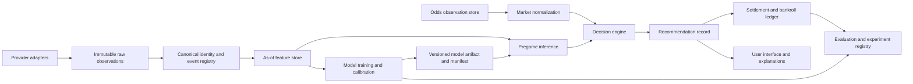

# NBA Prediction Project Integration Blueprint

**Audit date:** 2026-10-19  
**Primary repository:** `/Users/hakeembraimah/Documents/sb-model/football_model_starter`  
**Primary NBA package:** `nba/`  
**Purpose:** prepare the audited NBA project for a later evidence-led integration without merging or changing model logic in this stage.

## Status language

- **Implemented and verified** means accessible code, data, tests, or a reproducible calculation supports the statement.
- **Implemented but not validated** means working code exists, but its predictive or betting value has not been established.
- **Planned or proposed** means the capability is an intended design or recommendation and is absent from the current execution path.
- **Unknown or unavailable** means the available project cannot establish the fact.
- **Recommended improvement** is an audit recommendation, not a current capability.

## 1. Integration position

The Python `nba/` package should remain the primary analytical skeleton. It contains the strongest verified asset in the available project: a deterministic, date-safe team-margin baseline with a separate calibration season, a later test season, input hashes, unit tests, and reproducible reports. It also provides normalized game, player-game, player-season, roster, depth, schedule, and report tables.

The current web application is an integration and presentation layer. It reimplements some NBA calculations in TypeScript, adds current context, performs current market comparisons, and contains a distinct player-prop SGP research model. Those capabilities should connect to the primary system through versioned contracts. Their predictive claims must remain separate from the verified Python team-only result.

The friend’s or secondary project was not present in the accessible workspace. No secondary repository path, commit, export, environment, dataset, model artifact, or test report was available. Consequently, this blueprint defines an intake boundary rather than naming components to merge. A later comparison must treat every secondary component as an untrusted candidate until it passes the same data-timing and evaluation gates.

No merge, source rewrite, training run, or configuration change was performed for this audit.

## 2. Primary architecture to preserve

### 2.1 Verified core

Preserve these behaviors as the locked baseline contract:

1. `nba.model.load_games` validates required columns, unique fixtures, legal completed scores, regular-season status, and normalized Toronto game dates.
2. `nba.model.design_matrix` encodes home and away team identity, non-neutral home court, and a rest-day difference calculated from prior appearances. It updates the last-seen date after all games on a date, preventing same-date result leakage.
3. `nba.model.fit_team_model` trains only on `day < forecast cutoff`, applies exponential age weights, and uses explicit ridge penalties.
4. `nba.backtest.run_backtest` performs daily walk-forward prediction, uses 2024-25 only to fit the probability scale, and evaluates 2025-26 as the saved final test.
5. `nba.reporting` creates schedule forecasts and human-readable reports from the same code and input hashes.
6. `nba.tests.test_nba` enforces temporal, input, calibration, API-client, and market-normalization invariants.

These behaviors form baseline version `nba-team-margin-b0`. Any integration must be compared against this version rather than silently modifying it.

### 2.2 Experimental components to isolate

Keep these modules available, but behind experimental interfaces until validation is complete:

- Player per-36 projections and the sign-constrained team-season translation in `nba/players.py`.
- Current 240-minute rotation allocation and roster change delta.
- Spread probabilities derived from a normal margin approximation.
- Current injury and news context in the web application.
- The TypeScript `player-copula-v1.1` SGP research model.
- Suggested-slip composition and the paper wallet.

The roster extension reproduces its saved outputs, but has no historical outcome test. The SGP holdout conditions on known participants and does not test offered lines, pregame DNP risk, sportsbook prices, or profit. These components may contribute ideas and interfaces; they are not substitutes for the verified baseline.

## 3. Target modular architecture



The boundaries matter more than the specific storage technology. Every record used for a historical decision must carry an observation time, source time where available, event identity, and a stable provider key. Derived features must be reproducible from records observed no later than the simulated decision cutoff.

## 4. Proposed interfaces

The examples below are proposed contracts. They were not added to the product code during this audit.

### 4.1 Provider observation envelope

```json
{
  "schema_version": "provider-observation/1",
  "provider": "licensed_provider_name",
  "provider_record_id": "opaque-id",
  "entity_type": "game|player|roster|injury|lineup|odds",
  "observed_at": "2026-10-19T14:00:00Z",
  "provider_updated_at": "2026-10-19T13:59:31Z",
  "event_id": "canonical-event-id-or-null",
  "payload_sha256": "hex",
  "payload_path": "restricted/raw/path",
  "license_profile": "contract-id-or-review-status"
}
```

`observed_at` records when the system obtained the record. `provider_updated_at` records when the provider says the underlying value changed. Historical simulation must use the earlier of the contractual availability rules and these timestamps. An observation fetched today cannot be treated as evidence that it was available yesterday.

### 4.2 Canonical game record

Required fields:

- `event_id`, `league`, `season`, `season_type`
- `scheduled_start_utc`, `venue_id`, `neutral`
- `home_team_id`, `away_team_id`
- `status`, `status_updated_at`
- final scores when complete
- source mappings and confidence

The existing ESPN `game_id` can remain a source identifier. A canonical ID should avoid making one provider’s identifier the permanent cross-provider key.

### 4.3 As-of roster and availability record

Required fields:

- `team_id`, `player_id`, `event_id`
- `observed_at`, `provider_updated_at`
- roster status, injury status, reported reason
- probability of playing or explicit unknown state
- projected minutes distribution, source, and model version
- confirmed starter/inactive indicator when known

Final game participation must be stored separately from the pregame estimate. Backfills must never overwrite the snapshot used for a prediction.

### 4.4 Feature vector

```json
{
  "feature_set_version": "nba-features-b0",
  "event_id": "canonical-event-id",
  "decision_cutoff": "2026-10-19T22:00:00Z",
  "values": {
    "home_team_rating": 3.1,
    "away_team_rating": -1.2,
    "home_court": 1,
    "rest_difference_capped": 1
  },
  "source_max_observed_at": "2026-10-19T21:57:00Z",
  "lineage_sha256": "hex"
}
```

Preprocessing parameters, imputation, scaling, and feature selection belong to a fitted fold artifact. They cannot be calculated once on all seasons and reused inside cross-validation.

### 4.5 Model artifact manifest

Required fields:

- model and feature-set versions
- Git commit and dirty-state declaration
- exact runtime and dependency lock
- input hashes and date coverage
- target definition and unit of observation
- train, tuning, calibration, and final-test periods
- hyperparameter search space and selected values
- fitted preprocessing and calibration artifacts
- metrics by fold, season, probability range, and predefined subgroup
- known limitations and approved uses

The current `model_state.json` is a useful start, but omits the Git SHA, code hash, exact runtime lock, `player_games.csv`, `preseason.csv`, test artifact hashes, and experiment decision record.

### 4.6 Prediction record

Required fields:

- `prediction_id`, `event_id`, generated time, decision cutoff
- model and feature-set versions
- expected margin, margin uncertainty, home/away probability
- team-only probability and each experimental adjustment separately
- injury/lineup uncertainty scenario
- source freshness and unresolved warnings
- explanation components that sum to the model output where applicable

The team-only probability must remain visible when a roster adjustment is shown. The saved 63.09% test accuracy belongs only to the team-only model.

### 4.7 Odds observation

Required fields:

- event, book, jurisdiction, market, period, selection, line
- American and decimal price
- `observed_at`, provider `price_updated_at`, suspension/closure status
- provider and affiliate IDs
- market settlement rules

The current comparison checks feature time against response fetch time, but a provider price can be much older. The decision engine must reject a quote whose `price_updated_at` is too old for the market or is earlier than the feature snapshot being compared with it.

### 4.8 Recommendation and settlement record

A recommendation is a historical fact and must be immutable. Store:

- model probability, conservative probability bound, no-vig market probability
- quoted price, edge, expected value, uncertainty reason
- qualification rule version and pass/fail reason
- stake, bankroll before, and whether the record is research-only or executable
- later closing price, settlement, profit, and bankroll after

Do not replace an unavailable sportsbook price with `1/model probability` in any payout or profitability calculation. Model-fair odds can be displayed as analysis only.

## 5. Compatibility requirements for the secondary project

Before a secondary feature, model, or data source can be considered, request a portable snapshot containing:

1. Repository URL or archive, exact commit, branch, and dirty-state report.
2. Complete dependency lock and runtime version.
3. Dataset manifest with source, license, unit, keys, coverage, hashes, and missingness.
4. Raw-to-normalized lineage or a legally shareable provenance manifest.
5. Target definitions and as-of feature-generation code.
6. Train/tuning/calibration/test boundaries and every random seed.
7. Model artifacts or deterministic rebuild command.
8. Experiment logs including failed or rejected variants.
9. Historical predictions, odds observations, and settlement records used for any betting claim.
10. Tests that fail on deliberate look-ahead, current-roster backfill, stale odds, duplicate games, and revised injury status.

An exported result table without code and timing lineage is not sufficient evidence. A notebook that was executed on a mutable data download is not sufficient without its data version and cell order. Reported accuracy without proper scoring rules and a locked out-of-time test is not comparable with the primary baseline.

## 6. Merge-candidate assessment framework

Evaluate each candidate independently.

| Candidate type | Earliest acceptable contribution | Required acceptance evidence |
|---|---|---|
| Data provider adapter | Isolated adapter producing the observation envelope | Schema tests, source timestamps, legal-use record, failure behavior, sample hash |
| Identity mapper | Mapping table or deterministic resolver | Collision tests, relocation/name-change handling, manual review queue |
| Feature group | Feature-builder module | As-of test, missingness policy, fold-local transform, stable ablation gain |
| Model | Prediction adapter implementing the model contract | Reproducible artifact, equal-budget temporal comparison, calibration, final locked test |
| Calibration | Postprocessor | Training/calibration separation, multiple-fold stability, untouched test |
| Odds normalization | Market adapter | Book/region/market identity, price-time tests, settlement tests, no-vig method |
| Recommendation rule | Decision policy | Archived executable prices, preregistered thresholds, uncertainty treatment, prospective record |
| Explanation/UI | Presentation component | Fidelity to prediction record, uncertainty warnings, no unsupported performance claim |

### Automatic rejection conditions

Do not merge a candidate into the primary decision path when any of these applies:

- It calculates rolling features without a shift/as-of boundary.
- It uses present-day rosters, final injury status, confirmed starters, or closing prices for earlier simulated decisions.
- It performed feature selection or hyperparameter tuning on the final test season.
- Its reported metric cannot be recomputed from supplied predictions and outcomes.
- It omits bookmaker, jurisdiction, market, line, and quote timestamp from a betting claim.
- It relies on a data source whose intended gambling/commercial use is prohibited or unresolved.
- It replaces missing market prices with model-fair odds in ROI or payout calculations.
- It cannot map players, teams, and events without silent fuzzy matches.

## 7. Model and feature comparison protocol

### 7.1 Baselines

Use the existing ridge model as `B0`. Add:

- `B-1`: current cumulative home-win rate for continuity.
- `B1`: online Elo or margin Elo.
- `B2`: regularized win logistic/probit model.
- `B3`: market-implied no-vig probability at the exact decision cutoff, once licensed history exists.

The market baseline evaluates whether basketball information beats the collective price. It should not be included as a feature in the first pure-model comparison because that would hide whether basketball features add information.

### 7.2 Time structure

Compare candidate historical cutoffs around 2010-11, 2014-15, and 2017-18 only after the Kaggle/licensed long-history dataset is versioned. Use expanding or capped rolling training windows. A workable protocol is:

1. Multiple development folds, each training on seasons before a validation season.
2. Hyperparameters and feature-selection decisions aggregated across those development folds.
3. A separate calibration season for each final fit.
4. One untouched final season used once for the release decision.
5. A prospective shadow period after release.

Because only four seasons are currently available, the saved split can verify the existing baseline but is too short for reliable selection among many models and feature groups.

### 7.3 Feature groups

Run both add-one-group and remove-one-group ablations:

- `G0`: team identity, home court, capped rest.
- `G1`: pace, opponent-adjusted offense/defense, Four Factors.
- `G2`: back-to-backs, schedule density, travel, time-zone and altitude.
- `G3`: timestamped expected player minutes and probability of playing.
- `G4`: lineups, continuity, role, age curves, bench quality.
- `G5`: stylistic interactions and opponent-specific player context.
- `G6`: season phase and other contextual features.
- `G7`: market price and movement, evaluated as a decision/stacking layer after the pure basketball comparison.

Every group needs an as-of availability test. Fit imputers, encoders, scalers, importance measures, and selectors within each training fold. Do not compute a correlation filter or SHAP ranking once on the full dataset.

### 7.4 Retention rule

Retain a feature group only when it:

1. improves mean validation log loss or Brier score by a preregistered practical amount;
2. does not materially worsen calibration slope/intercept or tail reliability;
3. improves or is neutral in most folds and at least two seasons;
4. survives a remove-one-group ablation;
5. uses information available at the decision cutoff;
6. has stable missingness and provider semantics;
7. remains useful after comparing with a market baseline; and
8. does not require complexity disproportionate to the gain.

Reject or simplify a feature when its benefit is isolated to one season, disappears after opponent/pace control, changes sign frequently, depends on revised data, or creates too many researcher degrees of freedom.

### 7.5 Model comparison

Use the same folds, tuning budget, feature versions, and calibration choices for each candidate. Compare ridge/probit/logistic first, then fixed-budget CatBoost, LightGBM or XGBoost and a tree ensemble only if the data volume and feature groups justify them. Record failures and non-improvements. Select the smallest model whose proper-score gains are stable; accuracy is secondary.

## 8. Data-source integration order

1. **Correct and freeze local provenance.** Version normalized schemas, add a raw manifest where redistribution is permitted, and fix the repeated row-level meaning of `unassigned_team_points` before anyone consumes it.
2. **Add a licensed historical basketball source.** Resolve whether the proposed Kaggle data can be used for this purpose and lock a version. A commercial feed may be required for production.
3. **Add timestamped roster, injury, and lineup history.** This is the prerequisite for evaluating the current roster model and player props.
4. **Add immutable odds history.** Capture event/book/jurisdiction/market/line and both observation/update timestamps.
5. **Add current refresh adapters.** Keep manual refresh and 30-minute caching where quota is constrained, but archive every observation used for a decision.
6. **Add live data only after pregame validation.** A pregame model is not a live model; live state, clock, possession, foul, and market suspension need separate targets and tests.

NBA.com statistics present an explicit rights concern for this betting use case. The NBA Terms of Use reviewed for this audit restrict NBA Statistics to news/private non-commercial use and prohibit connection with gambling without the appropriate consent. Do not select a technical path before resolving rights.

## 9. Dependency strategy

### Python analytical environment

The current lower-bound-only `nba/requirements.txt` is insufficient for exact reproduction. Preserve the audited versions in a lock:

- Python 3.15.0
- pandas 3.0.6
- NumPy 2.5.4
- SciPy 1.18.1
- python-dateutil 2.9.0.post0
- six 1.17.0

Use a project-level environment definition and a supported Python version if deployment platforms do not yet support 3.15. Record system `curl`, which the HTTP client invokes. Add CI that rebuilds reports from hashes and verifies temporal tests.

### Web environment

The web package already has a lockfile and requires Node 22.13 or later. Keep TypeScript/web dependencies independent from the Python model lock. The audited direct versions include Next 16.3.4, React 19.2.6, TypeScript 5.9.3, Vinext 1.0.0-beta.5, Vite 8.0.13, Wrangler 4.92.0, Drizzle 0.45.2, and Zod 3.25.76.

Do not manually duplicate model formulas indefinitely. Generate a language-neutral model artifact and conformance cases, or serve inference from one implementation. If the TypeScript mirror remains, expand parity from three fixtures to randomized cutoffs, edge cases, and a large historical sample.

## 10. Recommended integration sequence and gates

### Phase 0 — Baseline freeze

Deliverables:

- tag or release manifest for `nba-team-margin-b0`;
- exact environment lock;
- input/output hashes, Git SHA, and dirty-state record;
- current tests in CI;
- explicit list of unsupported targets and unvalidated extensions.

Gate: a clean environment reproduces the 1,230-game metrics and saved reports.

### Phase 1 — Canonical data and as-of storage

Deliverables:

- canonical team/player/event mapping;
- immutable observation tables;
- versioned dataset dictionary;
- data-quality report with duplicate, join, missingness, and timestamp checks;
- licensed source decision.

Gate: a historical prediction can be rebuilt using only observations available by its cutoff.

### Phase 2 — Strong baselines and registry

Deliverables:

- Elo and probability-native regularized baseline;
- experiment runner and CSV/JSON registry;
- fold-local preprocessing and calibration;
- untouched final-test policy.

Gate: every result has reproducible predictions, config, hashes, and fold metrics.

### Phase 3 — Feature groups

Deliverables:

- efficiency/pace, schedule/travel, roster/availability, lineup/age, and contextual feature modules;
- add/remove ablations;
- season stability and missingness reports;
- smallest selected feature set.

Gate: accepted groups show stable proper-score improvement and pass as-of tests.

### Phase 4 — Market and decision validation

Deliverables:

- immutable odds observations and settlement rules;
- market-implied baseline;
- conservative EV decision rule;
- CLV, ROI, P&L, drawdown, edge-bin, and book/market reports;
- prospective shadow ledger.

Gate: decision metrics use executable timestamped prices. Research suggestions and qualified value bets are separate outputs.

### Phase 5 — Secondary-project intake

Deliverables:

- component-by-component mapping to proposed interfaces;
- license, dependency, schema, and identity conflicts;
- equal-fold experiment comparison;
- keep/rework/reject decision record.

Gate: no secondary component replaces the primary path without a reproducible improvement and compatibility evidence.

### Phase 6 — Product hardening

Deliverables:

- monitoring for schema drift, stale quotes, calibration drift, and missing lineups;
- safe fallbacks and visible uncertainty;
- role-based secrets and provider quota controls;
- deployment, privacy, and legal review;
- incident/rebuild runbooks.

Gate: the product can explain exactly which data and model version produced each recommendation.

## 11. Components that should not be merged yet

- Any friend-project model or feature because its files and evidence were unavailable.
- Current roster-adjusted probability as a replacement for the team-only baseline.
- SGP conditional holdout metrics with normal moneyline metrics.
- Football, NFL, or NHL evaluation code with NBA evaluation results.
- Current injury status or active rosters into historical examples.
- Suggested-slip research candidates with qualified positive-EV bets.
- Model-fair odds with sportsbook payout calculations.
- NBA.com statistical data into a gambling/commercial product without rights clearance.
- Live-betting logic into the pregame model.

## 12. First integration review checklist

- [ ] Secondary repository/export and exact commit received.
- [ ] All secrets removed; `.env` excluded.
- [ ] Source and license register completed.
- [ ] Dataset units, keys, hashes, and timestamps verified.
- [ ] Team/player/event mapping conflicts quantified.
- [ ] Current-roster and final-status leakage tests pass.
- [ ] Feature transforms are fold-local.
- [ ] Baselines run on identical chronological folds.
- [ ] Hyperparameter budget is equal and recorded.
- [ ] Calibration is fit outside the final test.
- [ ] Market quotes are executable, jurisdiction-specific, and timestamp-aligned.
- [ ] Metrics include log loss, Brier, calibration, and continuous-target errors.
- [ ] Betting claims include bet count, ROI, CLV, drawdown, and confidence intervals.
- [ ] Recommendation distinguishes best predicted outcome from an attractive price.
- [ ] Keep/rework/reject decisions are entered in the experiment register.

The future combined project should look like the primary system with better adapters, features, models, and evidence—not like two codebases concatenated together.
